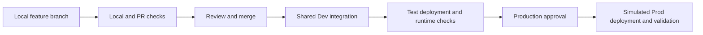

# Control coverage and development workflow

Updated 28 October 2026 from the organizer's supplied Working Version 1 guidelines and subsequent scope decisions.

The current participant pilot provisions all nine role/environment workspaces from Unit 1. Model A/B progression increases control strength and coordination rather than requiring a move from combined workspaces into separate roles. The exact native-promotion exercise remains to be tested for the selected cross-workspace dependencies.

## Agreed teaching boundary

- Model A: hands-on controlled native delivery, including source traceability.
- Model B: hands-on local feature branches, PR/CI, shared Dev integration, automated deployment, configuration, approval, runtime validation, and recovery.
- Model C: short explainers on escalation triggers and stronger control boundaries. No required Model C implementation.
- Feature workspaces: explain when isolated Fabric testing or UI authoring makes them useful. No required provisioning or branch-workspace lifecycle exercise.

The organizer's preparation repository holds the workshop assets. Each participant/pair starts with an unpopulated Azure DevOps solution repository and creates the introductory Fabric assets manually. Recommend one solution repository with role folders. The core exercises follow one developer; pair concurrency is optional. See [repository and bootstrap design](repositories-and-bootstrap.md).

The correct model follows productive risk and dependency. Three workspace roles do not automatically imply Model C. The workshop itself remains a training sandbox with synthetic data and simulated production.

## Preferred Model B workflow

Assumption: shared Dev is shared within each team, not across all participants. In the separated topology it is the team's Dev code/data/reporting set. Start with short-lived local feature branches and one integration branch, provisionally `main`. Avoid adding long-lived environment branches unless the technical experiment establishes a need.

The diagram describes control flow. A release must carry the same selected source revision through Test and Prod even if `main` advances. Shared Dev may receive later commits; it must not silently become the mutable source of an earlier release.

### Local work

Design the mandatory Model B feature around artifacts that can be edited and meaningfully checked locally: notebook source, small Python transformation functions, supported text definitions, configuration, and pipeline YAML. Use definitions captured from the learner's earlier UI work, adding selected starter files as needed. Prepared exports are recovery/support material. Extract the business calculation into locally testable code if needed; do not promise that local tests reproduce Fabric Spark, security, connectors, or semantic-model behavior.

Checks before merge should cover configuration completeness, supported definition structure, forbidden target references where inspectable, and a useful calculation/data invariant. Actual deployed runtime checks occur after integration in shared Dev and Test. This workflow has no isolated pre-merge Fabric runtime; make that tradeoff explicit.

### Shared Dev rules

1. A team does not switch its shared Dev Git connection to each developer's feature branch. One workspace is a shared runtime, so branch switching would affect everyone using it [S12].
2. Choose one deployment authority per workspace. Validate either a Git-update path or API-based publishing; do not allow independent sync and publishing processes to compete over its state. Native promotion is a separate introductory exercise.
3. Once Model B integration is established, normal changes enter through local branches and PRs. The initial export from Fabric is a controlled bootstrap step.
4. Mandatory features should not require concurrent UI authoring in shared Dev. If a UI-only edit is needed, coordinate one editor, record the affected items and source revision, and rehearse a capture-to-feature-branch process that preserves pending changes. If this cannot be made reliable, keep that edit out of the mandatory exercise and explain the feature-workspace alternative.
5. Serialize deployment and integration tests for a team target. Record which revision produced each test result.
6. Local branches isolate source files, not runtime data. Use synthetic data, explicit environment mappings, and reproducible seeding.

Power BI Desktop or another client may support local changes for particular item types, but the workshop's required local tools and supported file formats must be chosen and tested. Avoid making multiple client installations a last-minute prerequisite.

Prefer validating a transition from native Git bootstrap to pipeline-published integration Dev for the required Model B feature. Retain a controlled Git-update Dev path as an alternative to assess against the current implementation. Teach one working mechanism and explain the tradeoff; Model B does not require a workspace Git connection. The transition must reconcile outstanding workspace changes and stop the previous writer before the new one is enabled.

### Feature-workspace explainer

A feature workspace provides a separate Fabric runtime for a branch. It becomes useful when developers need parallel UI authoring, incompatible schema changes, isolated data or execution state, or Fabric integration tests before merge. Its costs include provisioning, configuration, identity/data access, dependency binding, runtime startup, and cleanup. A feature Git branch by itself provides none of that isolation.

For this small mock project, start without feature workspaces. If experiments show a required feature cannot be developed or validated responsibly with the chosen shared-Dev path, change the feature or explicitly review that boundary before authoring the unit. Do not quietly add a full workspace-per-feature requirement.

## Minimum-control coverage

This is a teaching coverage plan, not a certification that the sandbox meets a productive standard.

| Control | Model A experience | Model B experience | Model C explainer |
| --- | --- | --- | --- |
| MS-01 Ownership | Name solution owner and support contact | Record technical/operational responsibilities and failure response | Formal service and escalation responsibilities |
| MS-02 Source control | Record supported definitions and custom code in Git | Feature branches and governed integration state | Stronger repository/release governance |
| MS-03 Change control | Link a visible change and promotion to a source revision | PR review and automated validation before integration | Stronger review gates and separation of duties |
| MS-04 Environments | Separate normal development and simulated production | Dev/Test/Prod; role split is an architectural choice | Additional isolation where required by risk |
| MS-05 Deployment/bootstrap | Repeat native promotion and explain clean bootstrap | Automated release plus a proven fresh-target setup path | Governed rebuild and critical recovery tests |
| MS-06 Configuration | Identify target-specific values | Separate environment maps; reject missing or forbidden references | Stronger configuration approval/audit/recovery |
| MS-07 Identities | Identify human, workspace, runtime/data-access roles | Show distinct CI execution, deployment, runtime, and data-access purposes; use supported non-human deployment | Approved workloads and stronger nonprod/prod identity separation |
| MS-08 Validation | Basic smoke check of deployed result | Automated target/runtime checks in Test and after simulated Prod | Risk-driven integration, negative-path and data-quality gates |
| MS-09 Authorization | Deliberate recorded promotion | Distinct production approval step, with lab bypass limits documented | Independent approvers and protected production capability |
| MS-10 Visibility | Find execution history and a failure | Useful failure evidence with named owner and next action | Proactive alerting, support expectations and retention |
| MS-11 Recovery | Explain a wrong-definition recovery | Redeploy known-good definitions; correct configuration; reseed only disposable data | Tested data/external-side-effect recovery where applicable |
| MS-12 Least privilege | Identify appropriate small-team access | Document developer/deploy/runtime permissions; test scoped automation identity | Stronger independent privilege governance |
| MS-13 Network/execution | Verify public/native path | Validate chosen runner and downstream connectivity | Private/restricted path, DNS/routing and connected agents where required |
| MS-14 Evidence | Retain source and promotion history | Correlate commit, targets, deployment, approval and checks | Centrally retained auditable evidence and retention rules |

For each tutorial unit, record the relevant MS IDs, observed evidence, and any sandbox simplification. Keep longer operational and governance topics in concise reference pages, with an exercise at the point where the topic matters.

## Workshop permission interpretation

The organizer will grant participants workspace admin on their team resources. This supports assignment of workspaces to native Deployment pipelines; pipeline permissions are a separate concern [S10]. It is a training choice, not a change to the supplied productive minimum standard.

Admin participants can bypass the intended release workflow by changing workspace contents or permissions. A successful approved pipeline run therefore demonstrates the controlled route, not that other routes are prevented. Show the intended production permission map and record this limitation for MS-04/MS-09/MS-12. No permission removal from participants is required for the core lab.

Configure the Model B approval as an actual Azure DevOps resource approval/check rather than describing a YAML condition as an independent approval [S11]. A teammate or facilitator can approve within the workshop setup; formal independent control and resistance to administrator bypass remain Model C explanation topics. Do not imply that protecting only an Environment name secures all access to production credentials or Fabric.

## Four state types as a recurring teaching device

Ask at each checkpoint which state changed:

- **Code:** feature edit, commit, or merge.
- **Deployment:** target item definitions installed or updated.
- **Environment:** target bindings, settings, connections, identities, and permissions.
- **Runtime:** executed jobs, created tables/data, refresh state, and outputs.

Use the recovery exercise to show why reverting a source commit does not automatically restore all four states. This is a core A/B lesson from the supplied Principles & Scope.
