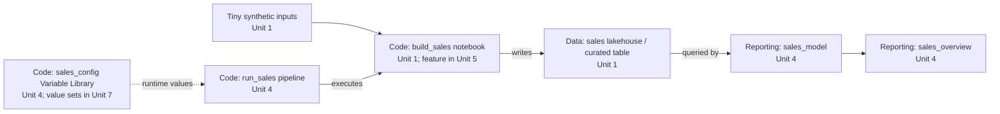

# Curriculum and sample growth

Updated 10 November 2026. Units 1–6 have organizer-reported success. The organizer accepted Unit 7's lesson with a clarification about static validation. Unit 8 Part A supplies the live Dev preflight. The publishing continuation and Units 9–12 describe the proposed sequence and target state.

## Teaching journey

Build a small working solution first, release it with native controls, then strengthen the delivery workflow as the fictional business dependency grows. Model A is a legitimate operating model for appropriate risk; participants are not trying to earn a higher model by accumulating tools.

All nine workspaces exist from the start. Assets go directly into their intended code, data or reporting role. We progressively use the layout rather than move items between workspace roles halfway through the workshop. The first native exercise deliberately covers only the lakehouse/notebook slice; reporting arrives later and does not have to support both required deployment paths.

The workshop is a training sandbox. The fictional solution is assessed as productive for teaching purposes. Participants' Admin rights mean the demonstrated delivery route can be bypassed; successful exercises do not establish productive enforcement.

## Sections and units

Times below include introductions, exercises and checkpoints. They are estimates to test, not observed learner durations. Starter snippets/templates enter when needed; participants do not implement a deployment library or an entire reporting solution from scratch.

### Section 1 — Understand the setup and build the first result

| Unit | Min | Work and observable checkpoint | Main controls |
| --- | ---: | --- | --- |
| **0. Observe and test the setup** | 20 | Inspect the nine workspaces, Azure DevOps resources, Git connections and access. Explain the three different kinds of pipeline and four types of state. Existing content stays parked. | MS-01, 04, 07, 12, 13 |
| **1. Create a tiny sales solution** | 45 | Manually create a lakehouse in Data Dev and notebook in Code Dev. Attach the cross-workspace lakehouse, add supplied deterministic input/logic, run it and check a known sales result. Record owner and intended operating model. | MS-01, 04, 06, 07, 08 |
| **2. Capture the solution in Git** | 25 | Commit supported definitions through Fabric using participant credentials. Inspect source, identities and role mappings; distinguish definitions from runtime state. Apply a Markdown-only Git edit back to Fabric, rerun checks and record per-repo source baselines. Participant estimate is 25–35 minutes; measure any reserve needed above this original slot. | MS-02, 03, 06, 14 |

### Section 2 — Release the small solution with Model A

| Unit | Min | Work and observable checkpoint | Main controls |
| --- | ---: | --- | --- |
| **3. Promote and verify with native Deployment pipelines** | 60 | Set up native promotion for the Data and Code workspace triplets. Deploy prerequisites before consumers, establish the target notebook/lakehouse binding through the validated mechanism, seed/run in Test, inspect the result, deliberately authorize simulated Prod promotion and repeat the smoke check. Record source, environment settings, promotion and a basic recovery/bootstrap procedure. | MS-02–11, 13, 14 |

This is a bounded two-asset exercise. The expected result is working Test/Prod output with verified target references, not simply green deployment status. No native Reporting pipeline is required. A fresh lakehouse definition must not be assumed to contain Dev data. A brief rerun of one small change shows repeatability; the fuller recovery exercise comes in Unit 11.

**Native gate outcome:** the organizer accepts the full Unit 3 human/native chain as its first working version on 4 November. This supports the declared two-role native bootstrap/binding/runtime path by report. Managed-identity deployment and new reporting/library relationships still need separate experiments; source rollback still does not imply data recovery.

### Section 3 — Grow the solution and introduce team development

| Unit | Min | Work and observable checkpoint | Main controls |
| --- | ---: | --- | --- |
| **4. Connect orchestration, configuration and reporting** | 60 | Create the Code Dev Variable Library and Pipeline, validate parameter flow, create the Direct Lake on SQL model and report, then raise the P01 price. Capture the refreshed 357.20 baseline in Git with its source and identity record. | MS-02, 04, 06–08, 10, 14 |
| **5. Make a local feature change** | 45 | Clone the Code source in VS Code, zero returned-order revenue and preserve Fabric metadata. Review, push and complete the first PR into `dev`. Record the merged revision and compare it with the live definition and the 357.20 runtime result. The feature expects 204.70. Allow 45–55 minutes with tools installed. | MS-02, 03, 08 |
| **[6. Turn review into a required check](../tutorial/section-03-team-delivery/unit-06-required-pr-validation/README.md)** | 35 | Start a second PR from merged `dev`. Wire the supplied notebook validator and Tiny Sales source check into CI YAML and attach required build validation. Observe a one-line revenue defect block that PR, fix it and complete the PR after the check passes. Record the PR and run IDs. | MS-02, 03, 08, 14 |

Use one sales table and a few measures/visuals. Unit 4 selects a browser-only Direct Lake on SQL pilot through the SQL endpoint creation dialog; actual reporting/Git representation and target identity support must still be observed before release automation is finalized. The core feature edits notebook/calculation source locally and does not require simultaneous UI editing or local Fabric Spark.

An optional companion covers local branch conflicts and Fabric workspace-versus-Git conflicts. Its hands-on steps need rehearsal with safe text edits and sit outside core time. [Conflict recovery companion](../tutorial/auxiliary/aux-01-recover-from-source-conflicts/README.md) · [Facilitator plan](../facilitator/source-conflict-exercise-plan.md).

### Section 4 — Automate the Model B release

| Unit | Min | Work and observable checkpoint | Main controls |
| --- | ---: | --- | --- |
| **[7. Fill the configuration mask and preview the release](../tutorial/section-04-release-automation/unit-07-configure-and-preview-release/README.md)** | 45 | Fill the YAML mask with workspace mappings, source pins, dependency intent and desired value sets. Add Test and Prod alternatives to the versioned Variable Library. Reuse the required build to reject a duplicated Dev mapping, then preview the corrected targets. | MS-03, 04, 06, 08, 12 |
| **[8. Publish and validate shared Dev](../tutorial/section-04-release-automation/unit-08-publish-shared-dev/README.md)** | 65 planned | Part A uses the approved runner identity to verify Dev workspace names and item IDs and record the exported relationships. For the publishing continuation, reconcile pending Git changes, establish one publisher, publish the reviewed snapshot including the validation notebook, and verify settings, bindings and runtime results. Capture 357.20 gross and 204.70 revenue. | MS-03, 05–08, 10, 12–14 |
| **9. Release the same source to Test** | 45 | Promote the Dev-validated snapshot across roles. Observe the validation notebook's first Test creation by managed identity and compare its ownership with an update to a human-created item. Record caller, target IDs and runtime/access evidence. | MS-01, 04–08, 10–14 |
| **10. Approve and release to simulated Prod** | 30 | Use a real resource approval and the source validated in Test. First-create the same new item through the Prod managed identity, inspect owner/default/runtime/connection identity observations and run post-deployment checks. Retain release evidence and explain Admin lab bypass limits. | MS-01, 03, 05, 07–12, 14 |

The preferred Dev mechanism remains pipeline publishing, subject to validation. Controlled Git-update Dev is the alternative to assess, not a second required implementation. Native pipelines from Unit 3 become a comparison/reference path; normal Model B changes use the selected automation route. Do not keep competing native/manual and automated publishers active for the exercise.

The observed pilot has three repos, whereas the recommended participant architecture is one solution repo with role folders. Resolve the workshop choice before finalizing Unit 2 and local-development instructions. A final three-repo path needs a release record pinning each repo revision; a single commit cannot represent all three. Avoid a mandatory repository migration exercise merely to reconcile our pilot with the recommendation.

### Section 5 — Operate, recover and reuse

| Unit | Min | Work and observable checkpoint | Main controls |
| --- | ---: | --- | --- |
| **11. Diagnose a failure and recover** | 55 | Trigger a safe, rehearsed failure in Test after part of a release has succeeded. Use deployment/runtime evidence to identify the failed step, correct configuration or redeploy a known-good definition, and rerun to a verified state. Explain why source rollback does not restore data and why cross-workspace release is not a transaction. Record the owner and next action. | MS-01, 05, 06, 08, 10, 11, 14 |
| **12. Reuse the suite and choose the right controls** | 20 | Fill the mask for a small second example, select its project check and run validation and planning with the same functions. Explain which parts change for another project and identify when Model C controls or feature workspaces would help. | MS-01–14 recap, especially 05, 09–12, 14 |

The second example is a small reuse check, not another complete cloud deployment. Full starter portability needs its own organizer feasibility test. Model C explainers cover independently protected production capability, separation of duties, stronger identity boundaries, monitoring/evidence retention, private execution where required, and risk-appropriate recovery. These remain obligations from the supplied guidelines, not claims that the sandbox implements them.

## Target state after Unit 12

- **Delivery workflow.** Participants have completed a reviewed feature merge, seen required CI block a faulty follow-up change, and released one selected source snapshot through Dev, Test and approved simulated Prod. A snapshot records the required repository revisions and the configuration used for that release.
- **Running solution.** The Tiny Sales items resolve to their intended workspace roles in each environment. Runtime evidence confirms the target Variable Library selection, six orders, 357.20 gross and 204.70 recognized revenue. The reporting check confirms the intended model and data source and shows 204.70 Total Revenue.
- **Repeatability and ownership.** Participants can use the release record to identify the source revision, deployed physical IDs, bindings, caller, runtime result and approval. They compare first creation of a validation notebook by managed identity in Test and Prod with an update to a human-created item. They rehearse recovery from a partial failure in Test and verify the recovered result.
- **Reusable handoff.** Participants leave with modular functions, Azure Pipelines templates, the filled Tiny Sales mask, a field reference and a second example. They can fill the mask, preview a plan and use a project-specific check while leaving the generic function suite intact.

## Proposed function suite and configuration mask

Use a **versioned YAML form** for the mask. Give learners a starter to fill in, a field reference and validation messages that point to the field they need to fix. Keep Tiny Sales assertions in a project check. The generic functions call the check through a documented input and delegate Fabric operations to the supported tooling selected during the pilot.

| Module | What the participant sees | First use |
| --- | --- | --- |
| Validate inputs | Actionable results for source, configuration and project checks. CI uses the same entry point. | Unit 6, with the mask added in Unit 7 |
| Resolve a plan | Read-only preview of selected revisions, declared workspace IDs, definition order and binding intent. Resolve physical item IDs during publishing. | Units 7–8 |
| Publish and configure | Apply the approved plan, resolve deployed IDs, establish bindings and select or verify the target value set. | Unit 8 |
| Verify and record | Run target checks and capture results, IDs, source revisions and release evidence. Test and Prod reuse the same functions. | Units 8–10 |

The mask describes which versioned source and role folders to use, the destination workspace for each role, dependency intent and the selected value set and check. The pipeline passes the pinned revision set, target name and config path. Azure DevOps resources supply the approved identity and approval. Fabric's Variable Library supplies the runtime values consumed by the workload. Resolve physical IDs where the selected tooling supports it and record them in the plan or release evidence. Define the exact field names once the cross-workspace pilot proves which overrides are needed.

## Ownership as a thread through the series

Unit 4 records the human baseline. Unit 8 establishes identity boundaries and includes a new validation notebook in the snapshot exercised in Dev. Unit 9 observes its first Test creation by managed identity and compares it with an existing-item update. Unit 10 observes first Prod creation using the same selected source. [Ownership experiment plan](identity-and-ownership-experiment.md).

## How reusable automation enters the tutorial

Build, document and validate each starter here before its participant unit is offered. The learner path remains incremental: first observe the manual operation, then configure a small reusable component, then use it in a pipeline. Unit 0 is unaffected. The following is a delivery contract for preparation, not a claim that these components already exist.

| First unit | We prepare and test beforehand | Participant action / parameterization lesson |
| --- | --- | --- |
| 4 | Minimal Variable Library example and a proven pipeline-to-notebook parameter flow | Create the library manually; consume a value such as `environment_name` and inspect the received runtime value |
| 6 | Reusable validation entry point, project-specific assertions and a thin CI YAML example | Wire the check into the second PR and observe the required policy reject and then accept the change |
| 7 | Fill-in YAML mask, field reference, example values and plan validation | Fill role/workspace mappings, allowed references and intended active value set, then inspect a resolved plan |
| 8 | One reusable deployment/validation entry point plus a parameterized Azure Pipelines job/stage template | Wire a thin project pipeline to the starter; select environment/config/source inputs and understand identity setup; do not copy and modify the deployment implementation per environment |
| 9–10 | Tested Test/Prod stages, pinned-source handling, target checks and release record | Reuse the same implementation with the target's configuration; inspect approval and runtime evidence |
| 11–12 | Rehearsed fault/recovery and a second tiny example with different configuration/checks | Recover through the same entry point and demonstrate reuse without editing generic internals |

Keep three parameterization concerns explicit:

- **Runtime configuration:** the Variable Library holds a few non-secret values used by Fabric items. Start with `environment_name`; add target references only if a demonstrated consumer requires them. Proposed home: each environment's Code workspace beside the consuming Data Pipeline/notebook.
- **Deployment configuration:** versioned solution/environment files describe role routing, binding intent, target mappings and desired active value set. Resolve physical item IDs where supported instead of asking learners to copy all IDs. Do not rely on a library already existing to bootstrap its own deployment. If a fact appears in both a deployment map and a runtime value set, derive it or validate consistency rather than maintain contradictory sources.
- **Pipeline inputs and protected resources:** Azure Pipelines selects the environment and the already selected source snapshot and supplies documented config paths. Authentication uses the configured connection/identity; production approval is a resource check. Runtime parameters must not allow a release to substitute unvalidated source or bypass target/approval boundaries.

Use tool-native parameterization where it covers the need; add generic code only for proven gaps. Shared implementation belongs in `toolkit/` and `.azuredevops/pipelines/`; sample logic and assertions in `sample/`; documented example settings in `config/` or `examples/`. Unit resources link to those canonical assets. The supported bootstrap must pin/version the starter and keep the same implementation/source selection throughout the release.

### Variable Library feasibility and teaching checkpoints

The required outcome is a real value consumed during execution, its definition visible in Git, the correct target value set selected, and a wrong/missing setting detected during validation. A UI-only tour is insufficient. Place the first demonstration in Unit 4 so Unit 3 stays a two-asset native exercise; Model B then deploys and validates the library with the other Code items. Recheck the 60-minute Unit 4 estimate during the pilot rather than quietly adding required hours.

Current [Variable Library lifecycle guidance](https://learn.microsoft.com/en-us/fabric/cicd/variable-library/variable-library-cicd) states that active value-set selection is workspace state, absent from Git, and initially Default on import. Explicitly establish/check the target selection before running consumers; do not assume successful definition deployment selected Test or Prod. The [NotebookUtils guidance](https://learn.microsoft.com/en-us/fabric/data-engineering/notebookutils/notebookutils-variable-library) restricts direct library reads to the same workspace and currently lists a service-principal limitation. Prefer proving a same-Code-workspace Data Pipeline consumer that passes a value to the notebook; direct notebook library reads are optional until validated for the actual runtime identity. Deployment identity and runtime identity must be tested separately. These documentation claims were checked 29 October 2026; no workshop runtime result is established.

## Timing and supporting material

- Units 0–6: **4 h 50 min**, proposed Day 1 core.
- Units 7–12: **4 h 20 min**, proposed Day 2 core.
- Total core is **9 h 10 min**. With 90 minutes of distributed reserve, plan for **10 h 40 min** of working time plus breaks.
- A 12-hour working budget leaves up to 80 minutes for optional material.

Pre-read/reference pages cover a short ALM/Git glossary, classification and four states, identity purposes, and a local-tool/access checklist. Recap concepts when used. Facilitator material holds provisioning, approvals/service-connection setup, solutions, checkpoint recovery and timing evidence. The learner must observe the identity/approval boundaries even when a facilitator performs an administrative step.

Optional material: independent repo ownership, direct Git-connected versus pipeline-published Dev, feature workspaces, pair concurrency and additional Fabric item types. Keep these outside the core completion path.

## The mock project

**Working title: Tiny Sales — from manual build to controlled release.** A fictional small reporting solution starts with a few synthetic orders and later becomes a shared team-maintained data product. No external source system or personal/business data is required.

Use small versioned customers, products and orders fixtures or an equivalent deterministic generator. The notebook creates a single curated `sales` table containing the fields needed by the report. Store expected counts and monetary totals with the fixtures; choose and verify the actual numbers when implementing Unit 1. Do not reuse the historical lab's expected totals without reproducing its data.

Unit 1 starts with three customers, three products and six orders, quantity 13, two returned orders, and 342.20 gross and recognized revenue. Unit 4 raises the price of P01 and carries forward 357.20. Unit 5 excludes returns from revenue, yielding an expected 204.70 with 357.20 gross. The organizer reports Unit 1 completion in 20–30 minutes. The fixtures begin in memory and the notebook persists the curated table. [Canonical Unit 1 starter](../../sample/tiny-sales/unit-01-notebook.py).

| Item | Workspace role | First created | Important relationship |
| --- | --- | --- | --- |
| `sales` lakehouse | Data | Unit 1 | Holds deterministic inputs/curated sales; its SQL analytics endpoint is a platform-provided companion where the chosen model mode needs it |
| `build_sales` notebook | Code | Unit 1 | Reads/writes the intended environment's Data-role lakehouse |
| `sales_config` Variable Library | Code (recommended) | Unit 4 | Supplies non-secret runtime values to a same-workspace consumer; each target selects its active value set |
| `run_sales` Fabric Data Pipeline | Code | Unit 4 | Executes `build_sales`; connections/runtime permissions checked separately |
| `sales_model` semantic model | Reporting | Unit 4 | Reads the intended environment's curated sales; storage mode remains a feasibility decision |
| `sales_overview` report | Reporting | Unit 4 | Uses `sales_model`; a few visuals show revenue, order count and a basic quality result |

These names are illustrative, not implemented asset definitions. The accepted minimal sample now has six authored item types, including the required Variable Library. Do not make a custom Fabric Environment, Warehouse or Dataflow Gen2 mandatory without an explicit scope decision.

This shows data flow and execution, not an executable deployment-order graph. Each environment has its own corresponding items. The notebook depends on the lakehouse even though the data-flow arrow points from notebook to lakehouse.

### Creation and linking sequence

| When | What grows | How we establish/check the link |
| --- | --- | --- |
| Unit 0 | Infrastructure only: nine workspaces and the initial Azure DevOps resources | Inspect role/environment mappings and personal Git access; do not assume any solution assets exist |
| Unit 1 | Lakehouse, then notebook, then data | Explicitly attach the Data Dev lakehouse to the Code Dev notebook; execute and inspect expected output |
| Unit 2 | Versioned baseline | Capture definitions and inspect the lakehouse reference; compare Git with runtime data |
| Unit 3 | Minimal slice reaches Test and simulated Prod | Promote the lakehouse prerequisite, then notebook, configure/verify each target binding, execute in the target and verify environment isolation |
| Unit 4 | Variable Library, Data Pipeline, semantic model and report in Dev | Read the library through a same-Code-workspace consumer and pass the value to the notebook; model to Data Dev's table; report to model. Run end to end and capture definitions |
| Units 5–6 | First feature merge, then required checks on a second PR | Change recognized revenue while preserving the table schema. Introduce a deliberate defect to demonstrate the check blocking the second PR. |
| Unit 7 | Explicit environment/dependency configuration and library value sets | Inspect notebook/lakehouse, pipeline/notebook, pipeline/library, model/data and report/model relationships; distinguish desired active-set configuration from versioned library definitions |
| Unit 8 | Full Dev solution under one automated writer | Discover/create target items, resolve/inspect bindings, establish/check active value set, seed/run and refresh as required, then compare metrics |
| Units 9–10 | Full solution reaches Test and simulated Prod | Use pinned source, proven target-specific ordering/binding and runtime checks; confirm a Test/Prod run does not write into Dev |
| Units 11–12 | Recovery and portability evidence | Correct/redeploy and verify convergence; change a second example's config without changing generic implementation |

The actual automated order may include create-then-bind steps: storage prerequisites, deployable definitions, bindings/settings, runtime execution and consumption readiness are separate operations. Derive that order from V04–V07, not solely from this illustration. Do not assume deploying a semantic model also executes the notebook or makes its data ready.

## Decisions and evidence before detailed authoring

The organizer completed the native Test rehearsal and Units 3–6. Unit 7 exercises the declared role mappings and value sets offline before publishing begins. [Native Test rehearsal](../facilitator/unit-03-native-promotion-rehearsal.md) · [Unit 6 pilot notes](../facilitator/unit-06-pilot-notes.md) · [Unit 7 pilot notes](../facilitator/unit-07-pilot-notes.md).

1. **Native boundary (V03/V04/V07):** prove the two-role lakehouse/notebook exercise and its target settings. Reporting is intentionally not a prerequisite for completing Model A in this proposal.
2. **Reporting path (V06):** select one model mode/report representation, required client tools, deployment/identity support and a fast authoring route. Validate it before committing to Unit 4 instructions.
3. **Source layout (V17):** settle one repo/role folders versus the current three-repo pilot. Preserve what the pilot actually demonstrated and document release revision selection accordingly.
4. **Model B writer and identity (V02/V16):** choose one Dev mechanism and validate the runner's authentication, required operations and runtime permissions. Managed identity provisioning is planned, not evidenced as complete.
5. **Checks and time (V08–V14):** rehearse clean-target release, repeat deployment, partial failure/recovery, representative capacity load and timed completion. Adjust unit sizes from evidence.
6. **Variable Library (V19):** prove same-workspace consumption under the chosen runtime identity, pipeline/notebook parameter flow, Git definition capture, fresh-target active-set configuration, repeat deployment and an invalid-setting check. Keep this required asset in scope; resolve mechanism gaps before authoring its exercise.

Microsoft's [cross-workspace definition-binding guidance](https://learn.microsoft.com/en-us/fabric/cicd/cross-workspace-dependency-binding) warns against assuming that cross-workspace item references will remap. The [native deployment process](https://learn.microsoft.com/en-us/fabric/cicd/deployment-pipelines/understand-the-deployment-process) also describes specialized cross-pipeline stage binding. The [notebook guidance](https://learn.microsoft.com/en-us/fabric/data-engineering/notebook-source-control-deployment) describes target-stage deployment rules. These are mechanism-specific documentation claims, checked 29 October 2026; none passes our exact tenant experiment.

Use the [validation backlog](backlog.md), [control coverage](control-coverage.md) and [pilot log](../facilitator/pilot-log.md) for evidence. Unit coverage above identifies teaching touchpoints, not a claim that every obligation of a listed MS control is implemented in that unit.

Ownership preparation gate (V20): prove first creation, existing-item update, repeat deployment, exposed ownership/default identity and runtime/access under the selected managed Test/Prod identities. Keep ownership observation separate from takeover/identity reassignment; beta APIs are not required merely to demonstrate this topic.
