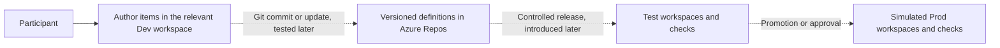

# Unit 0 — Observe and test the setup

Status: draft, 29 October 2026. The pilot's access checks have been reported successful; this new explanation and learner timing have not yet been piloted.

Estimated learner time: 15–20 minutes. Resources are pre-provisioned; organizer provisioning time is separate.

## Objective

Understand your training environment, identify what already exists and check that you can use it. Explain where source lives, where Fabric items run and how changes will eventually reach Test and simulated Prod.

This unit inspects existing resources. Manual asset creation, the first Fabric Git commit, deployment and execution follow in later units.

## 1. Meet the components

| Component | Purpose | Starting state |
| --- | --- | --- |
| Azure DevOps project | Organizes repositories and later delivery resources | Private training project |
| Git repositories | Store versioned solution definitions and changes | README and `dev` branch initialized |
| Fabric workspaces | Hold deployed items and environment-specific state | Nine empty workspaces |
| Fabric capacity | Provides resources used by Fabric workloads | Assigned to the workspaces |
| Workspace Git integration | Links a workspace to a repo, branch and directory | Three Dev roles prebound in this pilot |
| Participant access | Allows authoring and repository contributions | Workspace Admin plus separately granted DevOps access |
| Deployment automation and workload identities | Support controlled release execution | Introduced later; not established by workspace creation |

The preparation repository supplies the tutorial and selected starter files. Your Azure DevOps repositories hold the solution you will build. You will populate them gradually rather than import a completed solution.

**Exercise:** Open your Azure DevOps project and Fabric. Identify which components belong to each platform.

## 2. Find your nine workspaces

| Role | Dev | Test | Simulated Prod |
| --- | --- | --- | --- |
| Code | Develop executable/orchestration items | Validate released code | Run approved training code |
| Data | Develop using synthetic data | Validate target data/results | Hold training release data |
| Reporting | Develop consumption items | Validate target reporting | Show approved training results |

Three roles across three environments form one solution. For example, a notebook in Code Dev will use a lakehouse in Data Dev. Equivalent Test and Prod links must point to the intended environment; creating the workspaces does not establish those dependencies.

**Exercise:** Open each workspace. Identify its role/environment, verify intended capacity assignment and your Admin access, and confirm no solution items exist yet.

**Expected result:** You can access the complete matrix and explain its structure. Sharing a capacity does not provide independent compute capacity per workspace. Workshop Prod is simulated production with synthetic data; broad training access is a lab simplification.

## 3. Inspect source control

This pilot has three role-specific repositories in one project. Each Dev workspace connects to its own repository's `dev` branch and root directory (`/`). Test and Prod need not be Git-connected.

One solution repo with role folders remains an alternative for the final tutorial. With three repos, matching branch names do not identify one shared commit or atomic release.

**Exercise:**

1. Open each role repository and find its README and `dev` branch.
2. Confirm your participant account can contribute to the intended repos. An optional README edit can demonstrate this if not already checked; record that commit.
3. In each Dev workspace, inspect Git integration settings: repository, branch and directory.
4. Open each Dev Source control pane as the participant. Sign in as yourself if prompted and report errors without disconnecting working bindings.

**Expected result:** The mappings match the facilitator's assignment, and the panes are accessible. In this pilot's automatic-credential setup, prebinding does not make the organizer everyone's Git identity: each participant needs usable repository access. A configured shared connection would be a separate design choice.

These checks do not yet prove a Fabric item commit/update works. That will be tested using the first real asset. A README edit in Azure Repos only demonstrates repository contribution access.

## 4. Trace delivery and execution



Dashed arrows describe delivery behavior we will build and verify. A Git binding alone is not an automatically running CI/CD pipeline.

The **delivery flow** versions a change, selects its source state, deploys it and verifies the target. We will examine native promotion before introducing Azure Pipelines automation.

The **runtime flow** runs an orchestration pipeline/notebook, reads or writes data, and makes the result available to a model/report. Three different components use the word pipeline:

- A Fabric **data pipeline** orchestrates the data workload.
- A Fabric **Deployment pipeline** promotes supported items between workspace stages.
- An **Azure Pipeline** runs automation jobs, such as checks and deployment API calls.

The Azure Pipelines agent orchestrates delivery; Fabric executes the Fabric workload. Deployment and runtime/data-access identities have different purposes. Managed identity creation and agent setup come later.

**Exercise:** Find the native Deployment pipelines entry point and record whether it is available. No pipeline creation or deployment is needed here. Visibility does not prove promotion or target bindings work.

## 5. Explain the current state

| State | Meaning | What exists now |
| --- | --- | --- |
| Code | Versioned definitions and scripts | Initial README commits |
| Deployment | Definitions installed in workspaces | No sample items |
| Environment | Capacity, connections, permissions, settings | Provisioned training resources |
| Runtime | Jobs, tables, results | No sample execution |

A source commit does not by itself deploy items. Successful deployment does not prove successful execution. Reverting source does not automatically restore data.

This is a training sandbox. Models A/B describe controls for the fictional productive solution we will develop; workspace count does not determine its operating model.

## Checkpoint

Explain where you will edit source and inspect deployed items, which repository mapping belongs to each Dev role, why roles/environments are separated, and what remains untested.

```text
Unit: 0 — observe and test the setup
Nine workspaces accessible, empty, on intended capacity: yes / blocked
Workspace Admin and Azure DevOps contribution access: yes / blocked
Three Dev Git mappings and Source control panes checked: yes / blocked
Native Deployment pipelines entry point available: yes / blocked
Participant account differs from provisioning account: yes / no / unknown
Learner inspection time (excluding provisioning):
Unclear explanations, errors or deviations:
Optional README edit commit, if made:
```

Do not repeat checks already completed in the pilot; report only missing observations or corrections. Do not include credentials in feedback. If blocked, record the operation and message and ask the facilitator for help. Provisioning instructions are in the [facilitator reference](../../../facilitator/project-and-environment-provisioning.md).

Next: create the first Fabric assets manually in the relevant Dev roles. That unit is prepared from this checkpoint; sample execution and Git sync are not considered passed by this inspection.

## Coverage and reading

Introduces MS-01 (ownership), MS-02 (source location), MS-04 (environments), MS-07 (identity purposes), MS-12 (lab access), and MS-13 (initial access awareness). It is not a complete productive readiness assessment.

- [Fabric Git prerequisites](https://learn.microsoft.com/en-us/fabric/cicd/git-integration/git-get-started).
- [User-specific Git credential configuration](https://learn.microsoft.com/en-us/rest/api/fabric/core/git/get-my-git-credentials).
- [Workspace assignment to native Deployment pipelines](https://learn.microsoft.com/en-us/fabric/cicd/deployment-pipelines/assign-pipeline).
