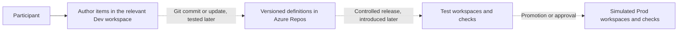

# Unit 0 — Observe and test the setup

Estimated learner time: 15–20 minutes. Resources are pre-provisioned; organizer provisioning time is separate.

## Objective

You’re starting with an empty environment that has already been set up for your team. Take a few minutes to find the Fabric workspaces and the Azure Repos project before you create anything. Later, when a notebook and a lakehouse have the same names in Dev and Test, the workspace names you record here will tell you which copy you’re looking at.

## Read the setup as a map of responsibilities

Picture a teammate asking for two things. First, they want to inspect the sales calculation before accepting a change. Then they want to see yesterday’s result. Where would you send them for each? Azure Repos will give them the versioned definition. Fabric will give them the workspace items and the output of a run. Today you’ll check that you can reach those places and find out which ones your team has been assigned.

Read a workspace name in two parts. **Code, Data and Reporting** tell you what the workspace is for. **Dev, Test and Prod** tell you where in the delivery process it belongs. A notebook in Code Test can use a lakehouse in Data Test. Those two workspaces serve different roles in the same environment. Keep that pair in mind when you find all nine workspaces. It will make more sense once you have real items to follow.

The workshop gives you broad access so your team can try the workflow end to end. As you open Azure Repos and Fabric, notice which system is granting access. In a shared project, a person might review source in Azure Repos while a designated operator handles releases to Prod. You’ll practice the separate decisions later, even if you’re wearing several hats here.

## 1. Meet the components

| Component | Purpose | Starting state |
| --- | --- | --- |
| Azure DevOps project | Organizes repositories and later delivery resources | Private training project |
| Git repositories | Store versioned solution definitions and changes | README and `dev` branch initialized |
| Fabric workspaces | Hold deployed items and environment-specific state | Nine empty workspaces |
| Fabric capacity | Provides resources used by Fabric workloads | Assigned to the workspaces |
| Workspace Git integration | Links a workspace to a repo, branch and directory | Three Dev roles prebound for the exercise |
| Participant access | Allows authoring and repository contributions | Workspace Admin plus separately granted DevOps access |
| Deployment automation and workload identities | Support controlled release execution | Introduced later; not established by workspace creation |

The preparation repository supplies the tutorial and selected starter files. Your Azure DevOps repositories hold the solution you will build. You will populate them gradually rather than import a completed solution.

**Exercise:** Open your Azure DevOps project and Fabric. Identify which components belong to each platform.

## 2. Find your nine workspaces

| Role | Dev | Test | Simulated Prod |
| --- | --- | --- | --- |
| Code | Develop executable/orchestration items | Validate released code | Run approved training code |
| Data | Develop using synthetic data | Validate target data/results | Hold training release data |
| Reporting | Develop consumption items | Validate target reporting | Show approved training results |

Three roles across three environments form one solution. For example, a notebook in Code Dev will use a lakehouse in Data Dev. Equivalent Test and Prod links must point to the intended environment; creating the workspaces does not establish those dependencies.

**Exercise:** Open each workspace. Identify its role/environment, verify intended capacity assignment and your Admin access, and confirm no solution items exist yet.

**Expected result:** You can access the complete matrix and explain its structure. Sharing a capacity does not provide independent compute capacity per workspace. Workshop Prod is simulated production with synthetic data; broad training access is a lab simplification.

## 3. Inspect source control

Your training project has three role-specific repositories. Each Dev workspace connects to its own repository's `dev` branch and root directory (`/`). Test and Prod need not be Git-connected.

Teams can also organize one solution repo into role folders. In this exercise, each repo has its own history. The three branches named `dev` will give you three separate commits to identify a release in Unit 7.

**Exercise:**

1. Open each role repository and find its README and `dev` branch.
2. Confirm your participant account can contribute to the intended repos. If the facilitator asks you to verify write access, make a small README edit and open its commit in Azure Repos to confirm it reached the shared repo.
3. In each Dev workspace, inspect Git integration settings: repository, branch and directory.
4. Open each Dev Source control pane as the participant. Sign in as yourself if prompted and report errors without disconnecting working bindings.

**Expected result:** The mappings match the facilitator's assignment, and the panes are accessible. In this pilot's automatic-credential setup, prebinding does not make the organizer everyone's Git identity: each participant needs usable repository access. A configured shared connection would be a separate design choice.

These checks do not yet prove a Fabric item commit/update works. That will be tested using the first real asset. A README edit in Azure Repos only demonstrates repository contribution access.

## 4. Trace delivery and execution



Dashed arrows describe delivery behavior we will build and verify. A Git binding alone is not an automatically running CI/CD pipeline.

The **delivery flow** versions a change, selects its source state, deploys it and verifies the target. We will examine native promotion before introducing Azure Pipelines automation.

The **runtime flow** runs an orchestration pipeline/notebook, reads or writes data, and makes the result available to a model/report. Three different components use the word pipeline:

- A Fabric **data pipeline** orchestrates the data workload.
- A Fabric **Deployment pipeline** promotes supported items between workspace stages.
- An **Azure Pipeline** runs automation jobs, such as checks and deployment API calls.

The Azure Pipelines agent orchestrates delivery; Fabric executes the Fabric workload. Deployment and runtime/data-access identities have different purposes. Managed identity creation and agent setup come later.

**Exercise:** Find the native Deployment pipelines entry point and record whether it is available. You will open this entry point again in Unit 3 to create the pipelines and verify their target bindings.

## 5. Explain the current state

| State | Meaning | What exists now |
| --- | --- | --- |
| Code | Versioned definitions and scripts | Initial README commits |
| Deployment | Definitions installed in workspaces | No sample items |
| Environment | Capacity, connections, permissions, settings | Provisioned training resources |
| Runtime | Jobs, tables, results | No sample execution |

A source commit does not by itself deploy items. Successful deployment does not prove successful execution. Reverting source does not automatically restore data.

This is a training sandbox. Models A/B describe controls for the fictional productive solution we will develop; workspace count does not determine its operating model.

## Checkpoint

Explain where you will edit source and inspect deployed items, which repository mapping belongs to each Dev role, why roles/environments are separated, and what remains untested.

```text
Unit: 0 — observe and test the setup
Nine workspaces accessible, empty, on intended capacity: yes / blocked
Workspace Admin and Azure DevOps contribution access: yes / blocked
Three Dev Git mappings and Source control panes checked: yes / blocked
Native Deployment pipelines entry point available: yes / blocked
Blocked step and exact error, if any:
```

Use the checkpoint to identify what needs fixing before you create any items. If blocked, share the operation and exact message with your facilitator, with credentials removed. Provisioning instructions are in the [facilitator reference](../../../facilitator/project-and-environment-provisioning.md).

Take the exact names of your assigned Code Dev and Data Dev workspaces into Unit 1. In Unit 2 you will use the Git mappings checked here to find the definitions you export. [Next: Unit 1](../unit-01-create-a-tiny-sales-solution/README.md).

## What you built and where it leads

You can now locate the places where Tiny Sales will be edited, executed and eventually released. If a teammate can open the Code repo and gets an error opening Data Dev, you have a specific place to start. Check the Fabric workspace assignment and access. If they can open Fabric and get an error pushing a branch, check their repository access.

Take a minute to sketch where the first notebook will live, where its table will live and where its definition will eventually be reviewed. Point to the three places in your team’s setup. In Unit 1 you’ll connect the first two and verify a real write. In Unit 2 you’ll take the first definition across the boundary to Git. The access checks today give you the starting conditions for those exercises.

## Coverage and reading

Introduces MS-01 (ownership), MS-02 (source location), MS-04 (environments), MS-07 (identity purposes), MS-12 (lab access), and MS-13 (initial access awareness). It is not a complete productive readiness assessment.

- [Fabric Git prerequisites](https://learn.microsoft.com/en-us/fabric/cicd/git-integration/git-get-started).
- [User-specific Git credential configuration](https://learn.microsoft.com/en-us/rest/api/fabric/core/git/get-my-git-credentials).
- [Workspace assignment to native Deployment pipelines](https://learn.microsoft.com/en-us/fabric/cicd/deployment-pipelines/assign-pipeline).
