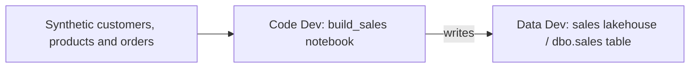

# Unit 1 — Create a tiny sales solution

**Time:** approximately 45 minutes, including the first Spark startup.  
**You will create:** one lakehouse in Data Dev, one notebook in Code Dev, and one curated sales table.

## What you will learn

By the end of this unit, you can:

- Explain why the notebook and its data live in different workspaces.
- Attach the intended Data Dev lakehouse to a Code Dev notebook.
- Produce and check a repeatable result from small synthetic inputs.
- Distinguish a working Fabric solution from a versioned, deployable solution.

## Before you begin

Complete [Unit 0](../unit-00-observe-and-test-the-setup/README.md). You need browser access to your assigned Code Dev and Data Dev workspaces, with permission to create and run items on their Fabric capacity. The notebook runs interactively using your signed-in identity, so that identity needs access to both workspaces. See Microsoft's [notebook execution guidance](https://learn.microsoft.com/en-us/fabric/data-engineering/how-to-use-notebook).

Keep the [notebook starter](../../../../sample/tiny-sales/unit-01-notebook.py) open in a second tab or editor. It contains all the supplied code; you do not need a local Python installation, package installation or external data source for this unit. If your viewer shows a preview, switch to its code/raw view before copying.

Identify these two assigned workspaces before creating anything:

| Your resource | Purpose |
| --- | --- |
| **Data Dev workspace** | Holds the `sales` lakehouse and its data |
| **Code Dev workspace** | Holds the `build_sales` notebook that creates the table |

Use the exact workspace names from your assignment. Test, Prod and Reporting workspaces are used in later units.

## Understand what you are building

Tiny Sales is a fictional shop with three customers, three products and six orders. The supplied code joins these inputs into one table suitable for reporting. Each row represents one order; for this sample an order contains one product and a quantity.

The **notebook** contains executable logic. The **lakehouse** stores files and tables in OneLake. Its **default lakehouse attachment** tells Spark where to resolve an unqualified table name such as `sales`. It is an environment-specific relationship, even though both workspaces belong to the same team. Microsoft's [lakehouse/notebook guide](https://learn.microsoft.com/en-us/fabric/data-engineering/lakehouse-notebook-explore) explains the default attachment.

This is a training sandbox. We will use a fictional low-risk productive scenario to learn Model A controls, then strengthen the workflow for Model B. Workspace separation alone does not determine an operating model. In this exercise, you are the solution owner and initial technical contact.

## 1. Create the lakehouse in Data Dev

1. Open your **Data Dev** workspace in Fabric. Check its full name before proceeding.
2. Select **New item**, search for **Lakehouse**, and create a lakehouse named **`sales`**.
3. Keep **Lakehouse schemas** enabled in the creation dialog.
4. Open the new lakehouse. Under **Tables**, find the default **`dbo`** schema. It should not yet contain the sample table.
5. Keep this lakehouse open in a browser tab so you can return to it after running the notebook.

**Expected result:** Data Dev contains the `sales` lakehouse. Fabric also provides its associated SQL analytics endpoint; you do not need to configure it for this exercise. The table itself does not exist yet.

Schemas organize tables inside a lakehouse. Here, `sales` is the lakehouse name and `dbo.sales` will be the table's schema-qualified name. With a schema-enabled default lakehouse, an unqualified table name goes to `dbo`. See [Lakehouse schemas](https://learn.microsoft.com/en-us/fabric/data-engineering/lakehouse-schemas).

## 2. Create the notebook in Code Dev

1. Open your **Code Dev** workspace in another browser tab.
2. Select **New item**, search for **Notebook**, and create a notebook.
3. Rename it **`build_sales`** using the notebook title/menu.
4. Select **PySpark (Python)** as the code language. Use the workspace's supplied Spark environment; this exercise does not require a custom Environment item.
5. In the notebook's **Explorer** pane, select **Add data items → From OneLake catalog**.
6. In the catalog, locate **`sales`** in your **Data Dev** workspace. Select the **Lakehouse** item, rather than its SQL analytics endpoint, and confirm with **Connect** (labelled **Add** in some catalog dialogs). Check the workspace as well as the item name.
7. Make it the notebook's **default lakehouse** using the pin/default action. Verify that the explorer identifies the Data Dev lakehouse you selected.

**Expected result:** `build_sales` belongs to Code Dev and its pinned default lakehouse is `sales` in Data Dev. Do not create another lakehouse in Code Dev to make the attachment work.

Microsoft's [notebook attachment example](https://learn.microsoft.com/en-us/fabric/real-time-intelligence/map/tutorial-real-time-work-order-routing-application) illustrates the **Add data items → From OneLake catalog** path and the distinction between the lakehouse and its SQL analytics endpoint.

If a Spark session was already running when you changed the default lakehouse, stop/restart the session before executing the code. Changing the pin can require a restart; see [Connect lakehouses and notebooks](https://learn.microsoft.com/en-us/fabric/data-engineering/how-to-use-notebook#connect-lakehouses-and-notebooks).

## 3. Add the notebook cells and check the target

1. Add a Markdown cell above the code. Write **Tiny Sales — initial build**, your name/team and a sentence describing the notebook's purpose.
2. Open the [notebook starter](../../../../sample/tiny-sales/unit-01-notebook.py). It has four sections marked `# %% Cell 1` through `# %% Cell 4`.
3. Copy each section into its own PySpark code cell, preserving their order. Copy the Python source, without adding Markdown code fences. The `# %%` markers are comments and may remain in the cells.
4. In **Cell 1**, replace `REPLACE_WITH_YOUR_CODE_DEV_WORKSPACE_NAME` and `REPLACE_WITH_YOUR_DATA_DEV_WORKSPACE_NAME` with your exact assigned workspace names. Keep `EXPECTED_LAKEHOUSE` and `TABLE_NAME` as `sales`.
5. Run **Cell 1 only**. The first run starts a Spark session and can take longer than subsequent cells.
6. Compare its printed workspace/lakehouse names with your assignment.

**Expected result:** Cell 1 prints your Code Dev workspace, Data Dev workspace and default lakehouse `sales`, with no error. It has not written any data.

The code reads [NotebookUtils runtime context](https://learn.microsoft.com/en-us/fabric/data-engineering/notebookutils/notebookutils-runtime) and checks the target before writing. The two workspace names are explicit temporary configuration. Later units replace manual environment handling with documented configuration and reusable automation. The check uses your declared names; it supports the exercise but does not enforce a production security boundary.

## 4. Build and validate the sales result

1. Read **Cell 2**. Find the three input collections and the six orders. Two orders have `is_returned=True`.
2. Run Cell 2. It creates the inputs in Spark memory; these are not separate lakehouse tables.
3. Read **Cell 3**. Find the joins and these two calculations:
   - `gross_revenue`: quantity multiplied by unit price.
   - `revenue`: initially equal to gross revenue for every order.
4. Run Cell 3 and inspect its displayed rows and validation output.

**Expected result:** Six joined rows and a message beginning **`Sales checks passed:`**. The main checks are:

| Check | Expected result |
| --- | ---: |
| Rows / distinct orders | 6 / 6 |
| Total quantity | 13 |
| Returned orders | 2 |
| Gross revenue | 342.20 |
| Revenue | 342.20 |
| Invalid rows | 0 |

The initial business rule includes returned orders in revenue. Keep that rule for this unit; a later feature changes it. Monetary calculations use decimal values after converting integer-cent input prices, avoiding floating-point money calculations.

The checks validate the prepared result **before** persistence. A completed Spark job alone would not tell us whether a join dropped an order or produced the expected revenue.

## 5. Persist and inspect the table

1. Read **Cell 4**. Notice the second target check and the write mode **`overwrite`**.
2. Run Cell 4. It replaces the training `sales` table in the checked default lakehouse, reads it back and repeats the checks.
3. Confirm the final output contains **`UNIT_01_PASS: persisted sales table matches the baseline.`**
4. Return to the **Data Dev** lakehouse tab. Refresh the lakehouse explorer and expand **Tables → dbo → sales**.
5. Preview the table. Compare its six rows with the notebook output; sort by `order_id` if needed, because table previews need not preserve row order.
6. Return to the Code Dev workspace and confirm that `build_sales` is located there, while the lakehouse is in Data Dev. Wait for the notebook's save indicator to finish.

**Expected result:** The Data Dev lakehouse contains `dbo.sales` with six rows and the expected values. Code Dev contains the notebook. Both the prepared DataFrame and the persisted table passed validation.

This write deliberately replaces one disposable synthetic table. Use this starter only in the assigned training lakehouse. A full overwrite makes our tiny example repeatable; it is not an incremental loading or productive data-recovery strategy.

## 6. Rerun and explain what changed

1. Run all four code cells again, in order.
2. Confirm the final success message reappears and the table still has **six**, rather than twelve, rows.
3. Explain what would happen if the write mode appended the same inputs on every run.
4. Check the state table below against your environment.

| State | What this unit changed |
| --- | --- |
| Code | You authored notebook logic; capturing its definitions in Git follows in Unit 2 |
| Deployment | The notebook and lakehouse now exist in their Dev workspaces |
| Environment | The notebook has an explicit default-lakehouse relationship across workspace roles |
| Runtime | Spark ran, and the curated table/data now exist in the lakehouse |

Your working Dev solution is not yet a reproducible release. Git capture, target configuration and promotion are the next steps. The Variable Library and Fabric Data Pipeline arrive later, after this first notebook/lakehouse relationship is understood.

## If something does not work

| Symptom | What to check |
| --- | --- |
| Lakehouse or notebook creation is unavailable | Confirm the assigned workspace, creation permissions and capacity. Ask the facilitator to check the setup if the item type is unavailable. |
| The picker cannot find the Data Dev lakehouse | Check workspace selection, your access and the item's name. Keep the intended role split; report the picker/error rather than creating a substitute in Code Dev. |
| `Target check failed` | Check the two configured workspace names, the selected lakehouse and its default pin. After changing the attachment, restart the session and run from Cell 1. |
| Spark remains queued or fails before any code runs | Record the session status/error and elapsed wait, then contact the facilitator. Repeatedly starting new notebooks/sessions can add capacity load. |
| `spark` is undefined or a Spark API fails in a plain Python session | Confirm you created a Spark notebook with PySpark (Python), rather than a standalone Python notebook/session. |
| A variable/function is undefined | Run Cells 1–4 in order. A fresh session does not retain earlier variables. |
| Sales validation fails | Read the expected/actual values and compare the copied code with the starter, particularly joins, prices and the initial revenue rule. Keep the check; diagnose the mismatch. |
| Write/schema error, or no table appears where expected | Confirm schemas were enabled and the pinned lakehouse is correct. Refresh the lakehouse explorer. If an existing incompatible table is present, report it before deleting or changing its schema. |

## Completion checkpoint

- [ ] `sales` is a schema-enabled lakehouse in Data Dev.
- [ ] `build_sales` is a notebook in Code Dev, with that Data Dev lakehouse pinned as default.
- [ ] The target check prints the intended workspace/lakehouse names.
- [ ] Both runs end with `UNIT_01_PASS`; the persisted table still has six rows and revenue 342.20.
- [ ] You can explain why successful execution, Git capture and deployment are separate steps.

Keep the two item links and record your approximate completion time. If a check failed, keep the exact error and the step where it occurred so the facilitator can help. Leave the items and table in place for Unit 2; Git capture is the next activity.

## References

- [Explore lakehouse data with a notebook](https://learn.microsoft.com/en-us/fabric/data-engineering/lakehouse-notebook-explore) — lakehouse attachment and default selection.
- [Notebook attachment example](https://learn.microsoft.com/en-us/fabric/real-time-intelligence/map/tutorial-real-time-work-order-routing-application) — the OneLake catalog picker; use its notebook-connection steps as a UI reference only.
- [Use Fabric notebooks](https://learn.microsoft.com/en-us/fabric/data-engineering/how-to-use-notebook) — execution identity, code cells and session behavior.
- [Lakehouse schemas](https://learn.microsoft.com/en-us/fabric/data-engineering/lakehouse-schemas) — `dbo` and default table-name resolution.
- [NotebookUtils runtime context](https://learn.microsoft.com/en-us/fabric/data-engineering/notebookutils/notebookutils-runtime) — inspecting the notebook and attached lakehouse at runtime.

[Previous: Unit 0](../unit-00-observe-and-test-the-setup/README.md) · [Tutorial index](../../README.md)
