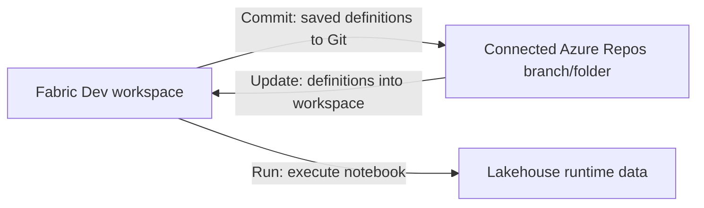

# Unit 2 — Capture the solution in Git

**Time:** approximately 25–35 minutes.  
**You will create:** versioned lakehouse/notebook definitions in Azure Repos and a recorded source baseline.

## What you will learn

By the end of this unit, you can:

- Commit a Fabric item's definition to its connected Git branch.
- Find the generated source files and explain logical IDs versus workspace item IDs.
- Distinguish lakehouse metadata and notebook source from runtime data and outputs.
- Apply a small Git change back to Fabric and verify the result.
- Record exact source revisions rather than relying on a moving branch name.

## Before you begin

Complete [Unit 1](../unit-01-create-a-tiny-sales-solution/README.md). Your Code Dev workspace contains `build_sales`, attached to the schema-enabled `sales` lakehouse in Data Dev. Its table has six rows and revenue 342.20, and rerunning the notebook succeeds.

You need your assigned Azure DevOps project, repository contribution access and the Dev Git connections inspected in Unit 0. Use your participant account in both Fabric and Azure DevOps. This unit uses the browser; cloning repositories and local feature branches come later.

The current training setup has separate role repositories, each connected on branch `dev` at directory `/`. Keep those existing mappings. Only **Data Dev** and **Code Dev** participate here; Reporting is still empty. One solution repository with separate role folders is another layout, but reorganizing the repositories is outside this exercise.

If a workspace has no Git connection, a different mapping, unexpected incoming changes or a policy blocking direct bootstrap commits, check with the facilitator before changing it. An initialization or update prompt is not an instruction to overwrite your Unit 1 work.

## Understand the two synchronization directions

Saving a notebook saves it in Fabric. A **commit** records its supported definition in Git. A Git commit made outside Fabric changes source first; **Update** applies the connected source to the workspace. Neither direction automatically runs the notebook.

Git records snapshots, identified by commits. A branch such as `dev` is a pointer that advances when new commits arrive. With separate repositories, two branches both named `dev` do not identify one shared source revision or an atomic release.

This is our initial Model A bootstrap: we deliberately commit to the connected integration branch. Later Model B exercises introduce feature branches, PR checks and controlled deployment. A Git connection alone does not implement that workflow.

## 1. Check where each workspace writes source

1. Open **Data Dev → Workspace settings → Git integration**. Read the existing connection without disconnecting or changing it.
2. Record its Azure DevOps project, repository, branch and Git directory in a personal copy of the [source-baseline worksheet](resources/source-baseline.md).
3. Repeat for **Code Dev**.
4. Open the two repositories in Azure DevOps under **Repos → Files**, using the repository selector and branch `dev`. Keep these tabs open.
5. Confirm the mappings match your assignment. A root directory `/` is appropriate here because each role has a separate repository; pointing multiple roles at the same repo root would mix their definitions.

**Expected result:** You can point from Data Dev to its repository and from Code Dev to its repository. You have not changed a workspace connection or created a branch.

Do not use the GitHub preparation repository as the destination. That repository supplies this tutorial; your Azure DevOps repositories hold the solution you are building.

## 2. Commit the lakehouse definition from Data Dev

1. In **Data Dev**, open **Source control** and inspect **Changes**. Refresh the pane if needed.
2. Sign in with your participant account if Fabric requests Git credentials. Workspace access and repository contribution access are separate permissions.
3. Locate the new `sales` **Lakehouse** item. Review its changes where the UI offers a comparison. Select the whole item for this initial commit.
4. Enter the message **`Add Tiny Sales lakehouse definition`** and select **Commit** to the connected branch. Do not choose **Commit to new branch** for this exercise.
5. Wait for completion. Confirm that the lakehouse no longer has uncommitted changes and is shown as synchronized, then refresh its Azure DevOps repository on `dev`.
6. Open the newly generated lakehouse item folder. Find its `.platform` file and the other exported metadata/configuration files. Exact supporting filenames depend on the item format and enabled tracking options.

**Expected result:** The lakehouse definition is visible in the Data repository and Fabric reports it synchronized. Your existing `dbo.sales` table remains in the lakehouse.

The workflow is documented in [Commit changes to Git](https://learn.microsoft.com/en-us/fabric/cicd/git-integration/git-get-started#commit-changes-to-git). A Fabric commit writes directly to the connected remote branch; there is no additional local Git push in this browser workflow.

## 3. Commit the notebook definition from Code Dev

1. Open `build_sales`. Confirm its introductory **Markdown cell** displays **Tiny Sales — initial build** above the four code cells. If it is missing, add it using [Unit 1, Section 3](../unit-01-create-a-tiny-sales-solution/README.md#3-add-the-notebook-cells-and-check-the-target); that cell is not part of the Python starter. Wait for the save indicator to finish, then return to **Code Dev → Source control → Changes**.
2. Select the whole `build_sales` **Notebook** item. Review the generated changes if available.
3. Enter **`Add Tiny Sales notebook baseline`** and **Commit** to the connected `dev` branch.
4. Wait for synchronization, then refresh the Code repository in **Azure DevOps → Repos → Files**.
5. Open the notebook item folder. Find **`.platform`** and **`notebook-content.py`**.
6. Read `notebook-content.py`. Locate your introductory Markdown text, the fixture inputs, the two expected Dev workspace names, the validation function and the write call.

**Expected result:** Your notebook logic is versioned in the Code repository. The source contains the checks you ran in Unit 1; it is the export of your actual Fabric notebook, not merely a copy of the tutorial's starter `.py` file.

Fabric's [notebook source format](https://learn.microsoft.com/en-us/fabric/data-engineering/notebook-source-control-deployment) stores cells and metadata as text. An optional `notebook-settings.json` may also be present; use the notebook UI to manage its Git settings rather than editing that file. Leave lakehouse auto-binding settings as supplied for this unit. Git capture does not prove the cross-workspace reference will remap during a later deployment.

## 4. Inspect what the source does and does not contain

1. In each item's `.platform` file, find its display name/type and **`config.logicalId`**. Record the two logical IDs in the worksheet. Keep these generated IDs unchanged.
2. In `notebook-content.py`, inspect the metadata describing its default lakehouse. It may include workspace/item IDs or logical references, depending on the saved settings. Record which representation you see; do not replace it by hand.
3. Open the lakehouse and notebook links in Fabric. Compare the item IDs in their URLs with the logical IDs in `.platform`. They serve different purposes; do not assume they are interchangeable.
4. Inspect the lakehouse source folder. Check whether it contains the six runtime table rows or a copy of the Delta data files. Inspect the notebook source for the displayed result grid.

**Expected result:** You can explain this distinction:

| Material | What is represented in Git here? |
| --- | --- |
| Notebook logic, Markdown and embedded synthetic fixture literals | Yes: they are source text in the notebook definition |
| Notebook cell output/result grid | No: execution output is not included in the notebook Git representation |
| Lakehouse identity and supported metadata | Yes: the exported lakehouse definition |
| Actual `dbo.sales` table contents and Delta data files | No: lakehouse runtime tables/data are not versioned by this integration |
| Two expected Dev workspace-name settings | Yes: currently explicit notebook source values |
| Participant permissions, authentication session and capacity assignment | Not established or restored by these two item definitions |

The input literals are in Git **because we put them in notebook source**. That does not make Git a backup of lakehouse runtime data. See [Lakehouse Git integration](https://learn.microsoft.com/en-us/fabric/data-engineering/lakehouse-git-deployment-pipelines).

A **logical ID** identifies an item in its source-control representation; a **physical item ID** identifies a concrete item in a workspace. Preserving a logical ID supports continuity, but it does not configure every dependency, permission or data-access path. See [Fabric Git source format](https://learn.microsoft.com/en-us/fabric/cicd/git-integration/source-code-format).

## 5. Apply a harmless Git change back to Fabric

1. Confirm **Code Dev** has no uncommitted changes. Wait for notebook edits to save, then close `build_sales` in Fabric, including any other open editor tabs for it. Keep the workspace item list open for the later Git update. If you are sharing the workspace, agree that nobody will edit this notebook during the round trip.
2. In the Code repository on `dev`, open the exported **`notebook-content.py`** and select **Edit**.
3. Find the introductory Markdown title **Tiny Sales — initial build**. Add **` (source controlled)`** to that title only. Preserve the existing comment prefixes, cell separators, metadata and Python code. If the title is absent from the exported source, follow the recovery note below before editing it.
4. Reread the edited title and commit this one-file edit to `dev` with the message **`Document Tiny Sales source-control baseline`**. The web editor's Commit dialog is not our diff-review step.
5. In **Azure DevOps → Repos → Commits**, open the commit you just created. Select `notebook-content.py` in its changed-files view and inspect its diff against the parent commit. Confirm that only the intended Markdown title changed. If anything else changed, correct it in a follow-up commit and review that result before applying source to Fabric. See [Azure Repos commit details](https://learn.microsoft.com/en-us/azure/devops/repos/git/commit-details?view=azure-devops).
6. Return to **Code Dev → Source control** and refresh. Inspect **Updates**: the incoming change should be the notebook edit you just reviewed.
7. Select **Update** to apply it. Updates apply the connected folder's incoming source rather than a selected file; proceed only when the listed incoming changes are the ones you expect and the workspace has no pending edits/conflicts.
8. Reopen `build_sales` from the workspace item list after Update completes. Confirm its introductory Markdown now includes **`(source controlled)`** and that its default lakehouse still points to Data Dev. If a saved-version/other-user warning appears, use the guidance below before editing or running it.
9. Run the notebook cells in order. Confirm **`UNIT_01_PASS`**, six rows and revenue **342.20** still result.

**Expected result:** The source change appears in the Fabric notebook, its Source control state is synchronized, and the unchanged business calculation still passes. Updating a definition and running that definition were two explicit actions.

**If the introductory title is missing:** return to the Fabric notebook and add the separate Markdown cell from [Unit 1, Section 3](../unit-01-create-a-tiny-sales-solution/README.md#3-add-the-notebook-cells-and-check-the-target). Save it, then commit the notebook from Code Dev with **`Add Tiny Sales notebook introduction`**. Refresh `notebook-content.py` in Azure Repos and continue this assignment from step 2. Create the cell through Fabric so its exported cell structure is generated for you.

This exercise writes only a documentation change to source. The subsequent notebook run still overwrites the disposable training table, as in Unit 1. If the incoming update contains unrelated edits, deletes or a conflict, stop and reconcile it with the facilitator; do not choose a force/overwrite option to get past it. Microsoft's [Git integration process](https://learn.microsoft.com/en-us/fabric/cicd/git-integration/git-integration-process) explains changes, updates and conflicts.

**If the open notebook shows an old version or an other-user warning:** first preserve any unsaved edits you actually intended to keep. In this exercise there should be none, because you saved and closed the editor before Update. Close/reopen the notebook or refresh its browser page to load the stored version, then compare the title with the reviewed Git commit. Do not overwrite the newly synchronized definition with an older editor copy. If the warning persists, the content is still wrong, or Source control now lists unexpected changes/conflicts, ask the facilitator to inspect the versions before saving again. An editor warning and a Git conflict listed in Source control are different observations.

Fabric supports [autosaved collaborative notebook editing](https://learn.microsoft.com/en-us/fabric/data-engineering/how-to-use-notebook#collaborate-in-a-notebook). For this exercise, explicitly taking turns between source editing and workspace editing makes the expected version easier to verify. Later, PR review gives us a review gate before integrating changes; the direct commit here is a small bootstrap exercise.

## 6. Record the baseline and explain the state

1. In Azure DevOps, open the **Data** repository's lakehouse commit using **Repos → Commits** or the file-history view. Copy the full commit ID and its link into your worksheet.
2. In the **Code** repository, open the latest commit containing your Markdown edit. Record that full commit ID/link as the final Code baseline; its snapshot includes the notebook logic from the earlier commit.
3. Inspect the displayed commit author/message and compare them with the account/workflow you used. Author metadata supports traceability; it is not, by itself, proof of which authentication credential was used.
4. Record the notebook/lakehouse item links and the successful runtime check. Reporting has no solution asset yet, so mark it **not used in this baseline** rather than inventing a third asset revision.
5. Keep your worksheet locally for the next unit. It is an exercise record, not yet a generic deployment manifest or an approved production release record.

**Expected result:** You have one exact source revision per participating repository. Another person can identify the definitions you captured without guessing which future `dev` branch head you meant. Microsoft's [commit-details guide](https://learn.microsoft.com/en-us/azure/devops/repos/git/commit-details?view=azure-devops) shows where to find the commit ID, files and author information.

| State | What happened in this unit? |
| --- | --- |
| Code | You captured definitions, then committed a small source change; each repo has its own history |
| Deployment | Git Update applied the notebook title change to Code Dev; Test/Prod were not deployed |
| Environment | Existing Dev Git mappings and lakehouse attachment remain relevant; the commit did not recreate permissions or configure other environments |
| Runtime | Rerunning the notebook checked the same six-row result; the commit itself did not copy or execute data |

## If something does not work

| Symptom | What to check |
| --- | --- |
| Source control requests authentication or denies a commit | Check the participant account, Azure DevOps organization/project/repo access and connection credentials. Ask the facilitator to inspect the setup; do not switch to another person's credentials. |
| Commit is disabled or Updates are already present | Check for incoming source and pending workspace edits. Review them with the facilitator rather than updating or undoing unfamiliar work. |
| A branch policy rejects the bootstrap commit | Ask the facilitator to confirm the intended bootstrap policy or provide the approved PR route. Do not bypass policy or change workspace branches. |
| The item does not appear under Changes | Confirm it is saved, refresh Source control, verify the workspace mapping and check whether the item is already synchronized. A synced item should already have source in the mapped repo/folder. |
| Azure Repos looks empty after committing | Check the selected repository, `dev` branch and connected Git directory, then refresh. Repository default branch and workspace branch need not be the same. |
| The notebook source has an unexpected representation | Check that you opened the Fabric-exported notebook item, not the tutorial starter. If `notebook-content.py` or `.platform` is absent, record the generated file list and ask the facilitator before changing formats. |
| Update reports a conflict | Keep both versions for review. Do not use Undo, force update or regenerate logical IDs as a shortcut. |
| No diff is visible in the Azure Repos web editor's Commit dialog | Commit the deliberate small edit, then open **Repos → Commits → your commit → changed file** to review its diff before Fabric Update. The file's **Compare** view can also compare committed versions. |
| Notebook shows older content or a saved-version/other-user warning after Update | Preserve any intended unsaved work, close/reopen or refresh the editor, and check the stored content against the reviewed commit. Do not save an old editor copy over it. Treat a listed Source control conflict separately. |
| Notebook rerun fails after the update | Confirm that only Markdown changed and inspect the pinned lakehouse/session. Preserve the exact error; do not weaken the data checks. |

## Completion checkpoint

- [ ] Data Dev's lakehouse definition is in its assigned Azure Repos location.
- [ ] Code Dev's exported notebook definition is in its assigned Azure Repos location.
- [ ] Both workspaces have no unexpected pending changes/updates.
- [ ] You identified and recorded the two generated logical IDs without editing them.
- [ ] A Git-authored Markdown edit reached Fabric through Update, and the notebook still passes.
- [ ] Your worksheet records the final Code and Data commit IDs/links separately.
- [ ] You can explain why these commits are neither a lakehouse-data backup nor a Test/Prod deployment.

Keep the items, repositories and table in place. Retain your worksheet, approximate completion time and any error text for the facilitator. The next unit introduces native promotion using this small solution.

## References

- [Get started with Fabric Git integration](https://learn.microsoft.com/en-us/fabric/cicd/git-integration/git-get-started).
- [Git integration process](https://learn.microsoft.com/en-us/fabric/cicd/git-integration/git-integration-process).
- [Notebook source control and deployment](https://learn.microsoft.com/en-us/fabric/data-engineering/notebook-source-control-deployment).
- [Lakehouse Git integration and deployment](https://learn.microsoft.com/en-us/fabric/data-engineering/lakehouse-git-deployment-pipelines).
- [Fabric Git source format](https://learn.microsoft.com/en-us/fabric/cicd/git-integration/source-code-format).
- [Azure Repos commit details](https://learn.microsoft.com/en-us/azure/devops/repos/git/commit-details?view=azure-devops).

[Previous: Unit 1](../unit-01-create-a-tiny-sales-solution/README.md) · [Tutorial index](../../README.md)
