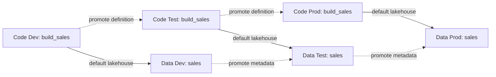

# Unit 3 — Promote and verify with native Deployment pipelines

**Time:** approximately 60 minutes.

**You will create:** Data and Code Deployment pipelines, target-specific notebook rules, and a verified Tiny Sales result in Test and simulated Prod.

## What you will learn

- Promote a small solution through Dev, Test and Prod with native Fabric tools.
- Explain resource names, logical IDs, physical IDs and environment-specific bindings.
- Configure a notebook's target lakehouse through a deployment rule.
- Verify execution after promotion and record deliberate production authorization.
- Explain the source, configuration and runtime steps needed for bootstrap/recovery.

## Before you begin

Complete [Unit 2](../../section-01-foundation/unit-02-capture-the-solution-in-git/README.md). Retain its source-baseline worksheet. Dev must still produce six rows and revenue 342.20.

Use the existing Code/Data Dev, Test and Prod workspaces on your assigned capacity. You need permission to create Deployment pipelines and assign those workspaces, plus ownership of the target notebook to configure its rule. Workspace and pipeline permissions are separate; ask the facilitator if an action is unavailable.

Prod is **simulated production**, containing synthetic data. Broad participant Admin permissions are a training simplification; this exercise demonstrates the intended route without enforcing every productive access boundary.

## Understand resources and their relationships

### Same source, different resources

A familiar on-premises workflow may hide location choices behind a shared catalog or centrally managed connection. In this Fabric layout, executable logic and persistent data are separate workspace items. Their relationship is environment configuration you must deliberately establish.

The dotted arrows do not copy table rows. A notebook can deploy successfully yet refer to the wrong lakehouse. The repeated display name `sales` alone cannot distinguish the environment.

| Identifier | Meaning here | What you do with it |
| --- | --- | --- |
| Display name | Readable item name, such as `sales`, repeated in several workspaces | Check it together with its workspace |
| Logical ID | Source-control identity in `.platform` | Preserve it rather than invent a replacement for each environment |
| Workspace ID | Identifies one concrete workspace | Use the target Data workspace ID in its rule |
| Physical item ID | Identifies one lakehouse instance in that workspace | Use the target lakehouse ID, not the Dev ID or logical ID |

IDs select resources; they do not grant permission. The notebook's execution identity also needs access to the selected lakehouse. See [Fabric source identities](https://learn.microsoft.com/en-us/fabric/cicd/git-integration/source-code-format).

### Why explicitly configure a deployment rule?

Fabric can auto-bind supported relationships, including some across Deployment pipelines with matching stage positions. This does not mean every resource reference is automatically rewritten. Here, the notebook and lakehouse occupy separate workspace roles, so we explicitly declare and verify the intended target. See [native binding behavior](https://learn.microsoft.com/en-us/fabric/cicd/deployment-pipelines/understand-the-deployment-process#autobinding).

A **Default lakehouse deployment rule** specifies the notebook attachment when deploying into a particular stage. It overrides auto-binding. If auto-binding already selected the right lakehouse, the rule still declares our chosen mapping; separate workspaces do not universally require manual rules.

Configure each target-stage rule once, then subsequent deployments apply it. This differs from editing the target notebook source after every release. The rule lives in the **Deployment pipeline view**, under the **target stage**. It is not a setting you find by opening the notebook editor. See [notebook rules](https://learn.microsoft.com/en-us/fabric/data-engineering/notebook-source-control-deployment#notebook-in-deployment-pipelines).

The rule is environment state, separate from the versioned Python logic. Recording its values makes the manual process reproducible. Later Model B units introduce reusable tooling and configuration for resolving such mappings.

## 1. Prepare one common notebook source

1. In **Code Dev**, replace only `build_sales`'s **first PySpark code cell** with the [environment-aware target cell](../../../../sample/tiny-sales/environment-aware-target-cell.py). Keep the Markdown and remaining three code cells unchanged.
2. Replace all six workspace-name placeholders with your assigned Code/Data Dev, Test and Prod names. Read the mapping: each Code workspace is allowed to use exactly one Data workspace.
3. Run all cells in Dev. Confirm environment `dev`, Data Dev's lakehouse and `UNIT_01_PASS` with six rows/revenue 342.20.
4. Save and commit through Code Dev Source control, using **`Make Tiny Sales target checks environment aware`**. Review the commit and record its full Code revision in the [release record](resources/native-release-record.md); retain the existing Data revision.
5. Close saved notebook editors and coordinate with your partner. Keep this baseline unchanged during Test and Prod promotion.

**Expected result:** One common source declares all three valid workspace pairs and rejects a Test/Prod attachment to Dev. You will not customize Python source separately in target stages.

Native Deployment pipelines promote saved source-workspace items; they do not automatically select a Git commit. We commit first, hold source unchanged and record revisions for this small manual release. Later automation will select and validate a pinned source snapshot more directly.

## 2. Create the two Deployment pipelines

1. Open **Workspaces → Deployment pipelines** and select **Create pipeline** or **New pipeline**.
2. Create `tiny-sales-data` with **Dev → Test → Prod** stages. Assign the existing Data workspaces to their matching stages.
3. Create `tiny-sales-code` with the same structure and assign the existing Code workspaces.
4. Verify the mapping below. If the pipelines already exist, reuse them after checking their assignments. Do not create additional target workspaces.

| Deployment pipeline | Stage 1: Dev | Stage 2: Test | Stage 3: Prod |
| --- | --- | --- | --- |
| `tiny-sales-data` | Data Dev | Data Test | Data Prod |
| `tiny-sales-code` | Code Dev | Code Test | Code Prod |

**Expected result:** Two native pipelines cover six existing workspaces. Reporting is unchanged. Stage positions, not just labels, matter where native cross-pipeline binding applies. See [pipeline setup](https://learn.microsoft.com/en-us/fabric/cicd/deployment-pipelines/get-started-with-deployment-pipelines).

## 3. Deploy the Data prerequisite into Test

1. Open **`tiny-sales-data`** and select the **Test target stage**.
2. Check **Deploy from = Data Dev** (your assigned source workspace). In the source items shown for that target, select the **`sales` Lakehouse** from Data Dev.
3. Review source **Data Dev**, target **Data Test** and the selected item. Deploy and wait for completion.
4. Open `sales` in **Data Test** as a **Lakehouse**, not its SQL analytics endpoint. On a fresh target, confirm `dbo` exists and the sample table rows have not been copied. Existing data may remain if you ran the target previously.
5. Record its lakehouse **item ID**, **name** and **workspace ID** in the release record. Obtain them from the actual Lakehouse/workspace URL, not `.platform` or the SQL endpoint.

**Expected result:** Data Test contains the prerequisite lakehouse definition, with its own physical identity. Definition deployment has not produced the six-row result. See [lakehouse metadata versus data](https://learn.microsoft.com/en-us/fabric/data-engineering/lakehouse-git-deployment-pipelines).

## 4. Deploy the notebook and configure its Test rule

1. Open **`tiny-sales-code` → Test target stage**. Check **Deploy from = Code Dev**, select `build_sales` from the source items and deploy. This establishes the target notebook; do not run all cells yet.
2. Stay in the **Code Deployment pipeline view**. On its **Test stage**, open the stage menu and choose **Deployment rules**. In the pane, select **`build_sales` → Default lakehouse** and add/configure the rule. The route is:

   **Deployment pipelines → tiny-sales-code → Test → Deployment rules → build_sales → Default lakehouse**

3. Inspect **From** and **To**. For this target, set **To = Other** and supply the **Data Test** lakehouse's ID, name `sales` and workspace ID recorded in Section 3.
4. Save the rule. Return to the **Test target stage**, retain **Deploy from = Code Dev**, select `build_sales` and deploy again to apply the rule.
5. Reopen the notebook from **Code Test** after deployment. Restart any old Spark session before checking the changed attachment. Run **Cell 1 only**.
6. Confirm environment `test`, Code Test, Data Test and the physical Test lakehouse ID you recorded. If it identifies Dev or fails, correct the rule and redeploy. Keep the guard and common source intact.

**Expected result:** Code Test's notebook uses Data Test's lakehouse through repeatable target-stage configuration.

| To option | Meaning | Choice here |
| --- | --- | --- |
| Same with source lakehouse | Retains the source attachment | Could retain Dev; do not use here |
| N/A / no default lakehouse | Removes the attachment | Our unqualified table write needs a default lakehouse |
| Other | Uses the specified lakehouse | Select the matching Data Test or Data Prod item |

Saving a rule does not itself redeploy. The rule takes priority over automatic binding and applies during subsequent deployment into that stage. See [rule behavior and fields](https://learn.microsoft.com/en-us/fabric/data-engineering/notebook-source-control-deployment#notebook-in-deployment-pipelines) and [the pipeline rule menu](https://learn.microsoft.com/en-us/fabric/cicd/deployment-pipelines/create-rules).

## 5. Validate Test and repeat

1. Once Cell 1 confirms the correct target, run Cells 2–4. Confirm `UNIT_01_PASS`, six rows and revenue **342.20**.
2. Inspect **Data Test → sales → Tables → dbo → sales**. Verify the persisted result in the Test lakehouse, not only the notebook output grid.
3. In the Code pipeline's **Test target stage**, keep **Deploy from = Code Dev** and repeat the notebook deployment with the existing rule. Reopen/restart as needed, rerun and confirm the same target/six-row result.
4. Record deployment/history and runtime results. Use the native pipeline's **Deployment history** for promotion status and the notebook run output/history for execution evidence. A deliberately different lakehouse attachment is environment configuration, not necessarily a code difference.
5. Confirm the recorded source has not changed since Test validation. If it has, stop and validate the new baseline before production promotion.

**Expected result:** Initial and repeat deployments use the intended Test target. The notebook execution creates/replaces the sample table; definition promotion does not copy Dev's rows.

## 6. Authorize and promote to simulated Prod

1. In your release record, enter the release purpose, your name/date, Code/Data baseline commits and the successful Test result. Explicitly record authorization for this training promotion. A partner may review it; this manual Model A decision is not an independently enforced approval gate.
2. Open **`tiny-sales-data` → Prod target stage**. Check **Deploy from = Data Test**, select the tested `sales` Lakehouse, review the operation and deploy.
3. Open the resulting **Data Prod** lakehouse. On first deployment, confirm schema support and the absence of copied sample rows. Record **its own** item ID, name and workspace ID; do not reuse Test IDs.
4. Open **`tiny-sales-code` → Prod target stage**. Check **Deploy from = Code Test**, select the tested `build_sales` notebook and deploy. Do not run all cells yet.
5. In the **Code Deployment pipeline view**, open **Prod → Deployment rules → build_sales → Default lakehouse**. Set **To = Other** with the **Data Prod** lakehouse ID, name and workspace ID. Save.
6. Return to the **Prod target stage**, retain **Deploy from = Code Test** and redeploy `build_sales` to apply the Prod rule.
7. Reopen the notebook from **Code Prod**, restarting an old session if needed. Run **Cell 1 only** and confirm `prod`, Code Prod and Data Prod with the recorded physical IDs.
8. Run Cells 2–4. Confirm `UNIT_01_PASS`, six rows and revenue 342.20. Inspect the actual Data Prod table and record deployment/runtime results.

**Expected result:** The same notebook logic progresses **Dev → Test → Prod**, with each target using its own lakehouse. Prod has its own rule; Test's rule is not a blanket setting for later stages.

If Prod still targets Test or Dev, correct the **Prod stage rule** and redeploy from the tested source. Do not patch target Python source. A green deployment badge is not a substitute for target and runtime checks.

## 7. Record bootstrap and recovery responsibilities

1. Complete the release record with source revisions, workspace/item mappings, target rules, Test validation, authorization and Prod validation.
2. Describe how to bootstrap a fresh target: provision/access the workspaces, deploy the lakehouse prerequisite, deploy the notebook, establish/apply its target rule, execute and validate. Capacity, permissions and configuration must also be reproduced; the two Git item definitions do not supply all of them.
3. Explain how to correct a wrong binding: update the stage rule, redeploy and validate. If source logic is wrong, correct/review it in Dev, repeat Test validation and authorize another promotion.
4. Explain why restoring source does not restore arbitrary historical data. This disposable sample rebuilds its table from controlled fixtures; productive data and external side effects require their own recovery plan.
5. Keep the pipelines, rules and target items for the later Model B comparison.

**Expected result:** Another person can identify what was released, which configuration made it runnable and what was checked. You can explain the manual steps and the lab's productive-control limits.

## If something does not work

| Symptom | What to check |
| --- | --- |
| Deployment direction looks wrong | Select the **target stage** first; inspect **Deploy from** and both workspace names before confirming. |
| Cannot find Deployment rules in the notebook | Return to the **Deployment pipeline view**, select the target stage and open its **Deployment rules** pane, then select the notebook. |
| Rule editing is unavailable | Check target item ownership and pipeline/workspace permissions with the facilitator. |
| Saved rule has not changed the attachment | Redeploy after saving, reopen the notebook and restart an old Spark session. |
| Target guard fails | Compare the six-name source map, actual context and target-stage rule IDs. Keep the guard; do not bypass it through target code edits. |
| Table missing after deployment | Execute the correctly bound notebook, then inspect its persisted result. |
| Target has no expected `dbo` schema | Ask the facilitator to inspect the source/target schema metadata before recreating resources. |
| Existing target already has data | Check for an earlier execution; definition promotion is not expected to clear runtime data. |
| Stage comparison shows metadata differences | Inspect which fields differ: intended target bindings differ, while unexpected source changes require review. |
| Open notebook shows an old version/warning | Preserve intended unsaved work, reopen/refresh after deployment and inspect the stored content. Follow Unit 2's recovery guidance; do not overwrite promoted content with an old editor copy. |
| Deployment passes but execution fails | The release is incomplete. Inspect configuration, runtime identity/access and the failing cell before retrying. |

## Completion checkpoint

- [ ] Data and Code native pipelines use the existing Dev/Test/Prod workspaces.
- [ ] Common notebook source is recorded in Git and retains target checks for all three declared pairs.
- [ ] Test and Prod have explicit notebook rules pointing to their own Data lakehouses.
- [ ] Test initial/repeat execution and Prod execution produce six rows/revenue 342.20 in the intended targets.
- [ ] Prod promotion was deliberate and recorded against the tested source baseline.
- [ ] The release record captures revisions, target IDs/rules and validation results.
- [ ] You can explain bindings, auto-binding limits, source versus data, and the bootstrap/recovery procedure.

Record completion time, UI differences and exact errors. Keep the assets for the next section, where orchestration, a Variable Library and reporting expand the solution before managed delivery is introduced.

## References

- [Deployment pipeline setup](https://learn.microsoft.com/en-us/fabric/cicd/deployment-pipelines/get-started-with-deployment-pipelines).
- [Deployment process and binding](https://learn.microsoft.com/en-us/fabric/cicd/deployment-pipelines/understand-the-deployment-process).
- [Create deployment rules](https://learn.microsoft.com/en-us/fabric/cicd/deployment-pipelines/create-rules).
- [Notebook deployment behavior](https://learn.microsoft.com/en-us/fabric/data-engineering/notebook-source-control-deployment).
- [Lakehouse metadata/data lifecycle](https://learn.microsoft.com/en-us/fabric/data-engineering/lakehouse-git-deployment-pipelines).
- [Fabric source identities](https://learn.microsoft.com/en-us/fabric/cicd/git-integration/source-code-format).

[Previous: Unit 2](../../section-01-foundation/unit-02-capture-the-solution-in-git/README.md) · [Next: Unit 4](../../section-03-team-delivery/unit-04-connect-orchestration-configuration-and-reporting/README.md) · [Tutorial index](../../README.md)
