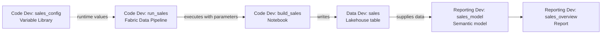

# Unit 4 — Connect orchestration, configuration and reporting

**Time:** approximately 60 minutes.

**You will add:** a Variable Library and Fabric Data Pipeline in Code Dev, plus an explicit semantic model and one-page report in Reporting Dev.

## What you will learn

- Pass a shared runtime setting through a pipeline into a notebook.
- Find the difference between configuration, orchestration, data and reporting definitions.
- Create and check a report that reads a lakehouse in another workspace.
- Record the dependency and identity information needed for later automated releases.

## Before you begin

Complete [Unit 3](../../section-02-model-a/unit-03-native-promotion/README.md). Keep its native pipelines and Test/Prod resources as the earlier working baseline. This unit develops the larger solution in **Dev**; its managed release follows later.

You need authoring access to **Code Dev**, **Data Dev** and **Reporting Dev**, including Power BI report/model authoring and browser model editing. Use the assigned workspaces; ask the facilitator to check licensing/tenant settings if those actions are unavailable. No Power BI Desktop installation is needed for this path.

Confirm Data Dev's `sales` lakehouse has `dbo.sales` with six orders/revenue **342.20**. Keep the [parameter-cell source](../../../../sample/tiny-sales/unit-04-parameter-cells.py), [measure definitions](../../../../sample/tiny-sales/sales-model-measures.dax) and a personal copy of the [Dev solution record](resources/dev-solution-record.md) available.

## Understand the complete flow

The **Fabric Data Pipeline** orchestrates this workload. It is different from the native Deployment pipelines used in Unit 3 and from the Azure Pipelines delivery automation we will add later.

The **Variable Library** stores typed, non-secret configuration. A pipeline reads its active values and passes them as notebook parameters. A **semantic model** defines reportable fields and measures; a **report** presents them. The model and report are independent items with a relationship, even when both are in Reporting Dev.

We will use **Direct Lake on SQL** for this pilot: the model references Data Dev's SQL analytics endpoint for metadata, while Direct Lake reads Delta data from OneLake. This is one explicit sample choice, not a rule that every project should use this mode. Do not silently accept a different mode in the creation dialog; record an unavailable option with the facilitator. See [Direct Lake development choices](https://learn.microsoft.com/en-us/fabric/fundamentals/direct-lake-develop).

## 1. Make the notebook accept runtime parameters

1. Open **Code Dev → build_sales**. Retain the common environment-aware target guard from Unit 3.
2. From [the parameter-cell source](../../../../sample/tiny-sales/unit-04-parameter-cells.py), copy the **Parameter cell** section into a new code cell **before** the existing target guard. Keep its defaults: `runtime_environment = "dev"` and `run_label = "interactive"`.
3. In that new cell's **… / More commands** menu, select **Toggle parameter cell**. Mark only this simple assignment cell as the parameter cell.
4. Copy the source file's **Runtime validation cell** section into another new code cell **after the target guard and before the input fixtures**. It checks the supplied environment against the common workspace map before any table write.
5. Read the order: parameters → target guard → runtime-parameter check → fixtures → transformation/checks → persistence/checks. There are now six code cells plus the introductory Markdown cell.
6. Run the notebook interactively from the top. Confirm **`UNIT_04_PARAMETERS_PASS`** with `dev`/`interactive`, followed by **`UNIT_01_PASS`** and the unchanged six-row result. Save the notebook.

**Expected result:** The notebook accepts explicit inputs while retaining its target guard. Pipeline execution can override the parameter-cell defaults. Those defaults are for interactive Dev; they do not choose a Test/Prod target automatically. See [notebook parameter cells](https://learn.microsoft.com/en-us/fabric/data-engineering/author-execute-notebook#designate-a-parameters-cell).

## 2. Create the Code Dev Variable Library

1. In **Code Dev**, select **New item**, find **Variable Library**, and name it **`sales_config`**.
2. Add these variables and save:

   | Name | Type | Default value |
   | --- | --- | --- |
   | `environment_name` | String | `dev` |
   | `run_label` | String | `tiny_sales_dev` |

3. Keep **Default** as the active value set for this workspace. Alternative Test/Prod value sets will be introduced with deployment configuration later.
4. Record the library item link and active value set. Store no credentials in this library.

**Expected result:** A real `sales_config` item supplies two Dev runtime values. The values do not themselves attach the notebook to a lakehouse or grant permissions. The active value-set choice is workspace configuration and is not stored in Git alongside the library definition. See [Variable Library lifecycle](https://learn.microsoft.com/en-us/fabric/cicd/variable-library/variable-library-cicd).

## 3. Create the orchestration pipeline and library references

1. In **Code Dev → New item**, select **Pipeline** and name it **`run_sales`**. This creates the Fabric Data Pipeline shown in the flow above.
2. Select blank space on the canvas so no activity is selected. In the bottom configuration panel, open **Library variables** and add these references using **New / + New**:

   | Pipeline reference name | Library | Library variable |
   | --- | --- | --- |
   | `EnvironmentName` | `sales_config` | `environment_name` |
   | `RunLabel` | `sales_config` | `run_label` |

3. Add a **Notebook** activity from the Activities pane and name the activity **`BuildSales`**. Select it and open **Settings**.
4. For this human-run baseline, leave **Connection** unselected (`Select…`) and select **Code Dev** and its **`build_sales`** notebook in the workspace/notebook selectors. An empty connection list (`No results found`) does not mean the notebook is missing: the connection controls execution authentication, while the other selectors identify the notebook. **Browse** opens connection selection; **Use Dynamic Content** supplies a connection reference by expression. Neither is needed for this baseline. Save and use the run check below to verify it; if your UI requires a connection or execution fails authentication, stop and ask the facilitator to check the supported authentication route rather than creating an arbitrary connection.
5. Open **Base parameters**. The parameters may auto-populate from the saved parameter cell; otherwise add the exact two names below with **String** type.
6. For each value, choose **Add dynamic content → Library variables** and select the matching pipeline reference. Inspect the generated expression:

   | Name (notebook parameter) | Type | Value (dynamic expression) |
   | --- | --- | --- |
   | `runtime_environment` | String | `@pipeline().libraryVariables.EnvironmentName` |
   | `run_label` | String | `@pipeline().libraryVariables.RunLabel` |

7. Save the pipeline and wait for the notebook/pipeline save indicators to finish.

**Expected result:** `run_sales` calls the existing notebook with values resolved from `sales_config`. Base parameters has **Name, Type and Value** fields. `EnvironmentName` and `RunLabel` are the references you created on the pipeline canvas; here they appear inside the expressions, not in a separate field. See [pipeline/library integration](https://learn.microsoft.com/en-us/fabric/data-factory/variable-library-integration-with-data-pipelines) and [Notebook activity](https://learn.microsoft.com/en-us/fabric/data-factory/notebook-activity).

The [pipeline definition schema](https://learn.microsoft.com/en-us/rest/api/fabric/articles/item-management/definitions/datapipeline-definition#tridentnotebook-activity-properties) makes the Notebook activity's connection reference optional. For the default human-context route, Microsoft documents execution under the **pipeline's last modifying user**, which can differ from the owner or person pressing Run. Record Connection as unselected, the pipeline's last editor and the notebook run's **Submitter** where shown. Submitter is useful evidence, not proof of every downstream access identity. Explicit connection-based authentication is a separate route we will revisit with workload identities. See [notebook execution contexts](https://learn.microsoft.com/en-us/fabric/data-engineering/how-to-use-notebook#security-context-of-running-notebook).

## 4. Run the pipeline and prove the configuration is used

1. In `run_sales`, select **Run** and open its run/activity details. Wait for `BuildSales` to complete.
2. Follow the notebook execution/output link from the activity details. Find **`UNIT_04_PARAMETERS_PASS`** and verify it received **`dev`** and **`tiny_sales_dev`**, rather than the interactive label.
3. Confirm the notebook's final `UNIT_01_PASS` and inspect the actual six-row Data Dev table. Record the pipeline/activity run and notebook output.
4. In `sales_config`, temporarily change `run_label` to **`unit04_check`**, save, then run the pipeline again. Confirm the new label appears in notebook output without changing notebook source. Restore `tiny_sales_dev` and save.
5. Perform one controlled failure: temporarily set `environment_name` to **`test`** in Code Dev's active Default values, save and run the pipeline. The runtime-parameter check must fail before the fixture/write cells, because Code Dev expects `dev`.
6. Restore `environment_name = dev`, save and run again. Confirm success. Keep only the correct final configuration for Git capture.

### Why the run snapshot shows two parameter cells

In the notebook execution's **Item snapshots**, expect your authored defaults cell followed by a generated cell containing the runtime values. Fabric inserts that second cell immediately below the marked parameter cell. Python executes the defaults first, then the injected assignments override them before the target guard and runtime checks execute. In this run, `run_label = "interactive"` is therefore followed by `run_label = "tiny_sales_dev"`. This is expected behavior, not a duplicate you need to remove.

Keep **one authored parameter cell**. Do not copy the generated runtime cell back into the notebook source or mark a second source cell as parameters. Verify the received values in `UNIT_04_PARAMETERS_PASS`, not just the defaults displayed above them. See [parameter override behavior](https://learn.microsoft.com/en-us/fabric/data-engineering/author-execute-notebook#designate-a-parameters-cell).

**Expected result:** The library value reaches actual execution, a wrong environment is rejected, and the restored configuration succeeds. A pipeline's failed status tells you to inspect the activity/notebook error; this deliberately failed run is useful validation evidence.

The notebook's existing target guard checks the attached lakehouse; the new check validates the environment parameter. A correct label alone cannot prove correct resource linkage. The data pipeline executes and validates data; it does not deploy this solution into Test or Prod.

## 5. Create the semantic model in Reporting Dev

1. Open the **SQL analytics endpoint** associated with Data Dev's `sales` lakehouse. Here we deliberately use the SQL endpoint creation entry point; it is different from the Lakehouse attachment used by the Spark notebook.
2. Confirm the endpoint can see `dbo.sales`. Newly written tables may need time to appear in endpoint metadata. Refresh and wait if needed; do not create another sample table to bypass missing metadata.
3. Select **New semantic model**. If a Direct Lake type choice appears, select **Direct Lake on SQL** explicitly. Name the model **`sales_model`**, choose **Reporting Dev** as its destination workspace, select only `dbo.sales`, then confirm creation.
4. Verify the model exists in **Reporting Dev**, while the source lakehouse remains in **Data Dev**. Use the inspection steps below to record the source endpoint, Direct Lake type and displayed connection/authentication details.
5. Open the model using **Open semantic model / Open data model**. Switch from Viewing to Editing if required. Confirm the model table is named **`sales`**; if the import gave it a schema-qualified name, rename it to `sales` in the model only, preserving its source binding and the physical `dbo.sales` table. Select that model table and create the five measures from [sales-model-measures.dax](../../../../sample/tiny-sales/sales-model-measures.dax), **one measure definition at a time** through **New measure**.
6. Format **`Total Revenue`** as a decimal with two places. The existing **`revenue` column** and the new **`Total Revenue` measure** are different fields; use the distinct name to avoid a naming collision. Browser model edits **autosave**; wait for any pending indicator to clear before leaving. There is no separate model Save step. No table relationships are needed for this one-table sample.

### Inspect the endpoint, model mode and connection

These checks answer three different questions: *where is the data*, *how does the model read it*, and *whose access is used*?

1. **Find the source server:** open **Data Dev → sales (SQL analytics endpoint) → Settings → SQL connection string**. Copy the displayed server into your private solution record; also retain the endpoint item link. It is an address, not a password. The lakehouse and its SQL endpoint are related items with distinct IDs; do not substitute the lakehouse ID for an endpoint/database reference. See [finding the SQL endpoint connection string](https://learn.microsoft.com/en-us/fabric/data-warehouse/how-to-connect#find-the-warehouse-connection-string).
2. **Inspect the model's connection:** return to the **Reporting Dev workspace list**, find the **Semantic model** row for `sales_model`, then select **… → Settings → Gateway and cloud connections**. Expand the data source, compare its displayed server/database with the intended Data Dev source, and record the connection selected under **Maps to** if shown. Do not select a different connection just to inspect it.
3. **Inspect authentication where exposed:** use the Fabric page's **Settings gear → Manage connections and gateways**, locate the connection displayed by the model and open its settings. Record the authentication method and SSO/fixed-identity setting if visible. A default/personal connection may expose fewer details; record what is actually shown rather than creating a new connection or changing credentials. See [cloud connection settings](https://learn.microsoft.com/en-us/power-bi/connect-data/service-connect-cloud-data-sources).
4. **Check Direct Lake:** open `sales_model` in the web model editor, select the `sales` table and inspect **Properties → Advanced → Storage mode** where available. Read the value; do not change it. `Direct Lake` alone does not distinguish **on SQL** from **on OneLake**.
5. **Confirm the type from its source expression:** in the model editor's **TMDL view**, drag **Model → Expressions** into the script area and inspect the shared data-source expression. A SQL Server connector (for example `Sql.Database(...)`) or `OneLake.SqlAnalytics(...)` identifies Direct Lake on SQL; `AzureStorage.DataLake(...)` identifies Direct Lake on OneLake. For this exercise, expect SQL and the Data Dev source. Read only: do not edit or Apply a script. If TMDL view is unavailable in your web editor, inspect the exported model's `.tmdl` expression files after Section 7's Git capture. Keep the creation-dialog choice as provisional evidence until the definition confirms it. See [Direct Lake connector identification](https://learn.microsoft.com/en-us/fabric/fundamentals/direct-lake-develop#power-query-connectors).

**Expected result:** An explicit model in Reporting Dev reads Data Dev and exposes reusable metrics. A separate model is created intentionally; creating a lakehouse does not supply a default semantic model for this exercise. See [model creation and destination selection](https://learn.microsoft.com/en-us/fabric/data-warehouse/create-semantic-model) and [web model editing](https://learn.microsoft.com/en-us/power-bi/transform-model/service-edit-data-models).

Model ownership, the connection's effective data-access identity and the report viewer are different concerns. With SSO, the querying user needs source access; fixed-identity connections use different access rules. Record the actual configuration rather than assuming the model owner's name describes every query. See [Direct Lake identities and access](https://learn.microsoft.com/en-us/fabric/fundamentals/direct-lake-security-integration).

## 6. Build and verify the one-page report

1. From the `sales_model` web editor, select **New report** to open a report canvas over that model.
2. Add three card visuals using the measures **Total Revenue**, **Order Count** and **Sample Check**. Set Total Revenue's display units to **None** and two decimal places if the visual shortens it. Choose the measure with the calculator icon, rather than the numeric `revenue` column.
3. Add a column chart with `sales[product_name]` on the category axis and **Total Revenue** as the value. Keep the page unfiltered while checking its baseline.
4. Save the report as **`sales_overview`** in **Reporting Dev**. Verify it did not save into My workspace or create a second semantic model.
5. Compare the report with these expected values:

   | Result | Expected |
   | --- | ---: |
   | Total Revenue | 342.20 |
   | Order Count | 6 |
   | Sample Check | PASS |
   | Backpack revenue | 245.00 |
   | Travel mug revenue | 59.70 |
   | Lunch box revenue | 37.50 |

6. Follow the visible-change exercise below. Record any readiness delay or refresh error.

### 6.1 Make a data change visible and capture the new baseline

1. In **Code Dev → build_sales**, find `PRODUCTS` in the input-fixture cell. Change only the **P01 Travel mug** price from **1990 to 2490** cents. This raises its unit price from 19.90 to 24.90; the three mugs across the orders add 15.00 to revenue.
2. In the transformation/checks cell's `EXPECTED_METRICS`, change **both** `gross_revenue` and `revenue` from `Decimal("342.20")` to **`Decimal("357.20")`**. These are deliberate, independently calculated expectations for the changed fixture. Keep all other checks and the target guard intact. Save the notebook, then close its editor.
3. Run **`run_sales`** and confirm success, including **357.20** in the persisted-table checks. Editing the source alone does not rewrite the table; the pipeline run does. Do not edit the Delta table directly: the next notebook run overwrites this training table from its fixtures.
4. In **Reporting Dev**, use the semantic model's **… → Refresh now** (or its available data-refresh action) and wait for completion. Then open `sales_overview` and refresh its visuals. Expect **Total Revenue 357.20**, **Travel mug revenue 74.70**, **Order Count 6** and **Sample Check PASS**. The other products stay unchanged. If the report still shows 342.20, check the successful write, model refresh and visual refresh in that order.
5. Keep the P01 price at **2490** and both expected monetary totals at **`Decimal("357.20")`**. Capture this revision in Section 7. Unit 5 starts from the updated fixture and changes the revenue rule.

**Expected result:** One report in Reporting Dev consumes `sales_model` and reconciles with the actual workload result. Direct Lake refresh updates its view of Delta data/metadata; it is not an Import-mode copy of the full table. Running the notebook, refreshing/framing the model and refreshing visuals are distinct actions.

The `Sample Check` measure checks only the known sample row/quantity/returns totals in the current filter context. It does not replace the notebook's monetary/data checks or validate the identity of the data source. See [Direct Lake overview](https://learn.microsoft.com/en-us/fabric/fundamentals/direct-lake-overview).

## 7. Capture the new definitions and identity baseline

1. Save all Dev items. In **Code Dev Source control**, commit `build_sales`, `sales_config` and `run_sales` with **`Add configured Tiny Sales orchestration`**. Review the resulting source in the assigned Code repo.
2. In **Reporting Dev Source control**, inspect its existing repo/branch/folder mapping from Unit 0, then commit `sales_model` and `sales_overview` together with **`Add Tiny Sales reporting baseline`**. Inspect the actual exported model/report files and preserve their generated logical IDs and relative references.
3. Record the full Code and Reporting commit IDs. The Data definition did not need changing for this unit; retain its previous source baseline.
4. Inspect the supported item details/settings for each new item. Where the UI exposes owner/creator or connection identity, record the exact label and principal shown in the Dev solution record. If it is not exposed, record that rather than using Take over to discover it.
5. Inspect the report-to-model link and model-to-data source in the exported definitions. Record the references actually present: logical IDs, endpoint/database references or relative paths. Finding **only logical IDs** in the item `.platform` files is expected; they are not a list of deployed physical IDs. For a concrete deployed item, retain its **Fabric item link** separately; where the URL clearly exposes its workspace/item IDs, record those as physical identity evidence. Do not infer an ID from an ambiguous URL or substitute a logical ID. See [logical versus physical IDs](../../reference/fabric-item-identities.md), including the API-based lookup we will use in later deployment work. A successful Git commit does not prove these dependencies will remap into another environment.

**Expected result:** The Dev solution is versioned across the existing role repos, and its configuration/consumption links are documented. Current human-created item and connection observations give us a baseline for a later new-item deployment through managed identity.

Frequent changes, shared consumers and stronger release expectations motivate Model B. Workspace count alone does not determine the model. The next feature exercise develops a local source change; later units introduce generic CI/deployment components, their parameterization and governed target releases.

## If something does not work

| Symptom | What to check |
| --- | --- |
| Parameters do not appear in the activity | Save the notebook, confirm the simple assignment cell is marked as the parameter cell and reopen Base parameters. Exact names/types must match. |
| Run snapshot shows two parameter cells | Expected: the authored defaults are followed by Fabric's runtime overrides. Keep one authored parameter cell; inspect the received values below it. |
| Connection picker shows No results found | For this baseline, leave it unselected and select the workspace/notebook separately. If the UI or execution requires authentication setup, ask the facilitator to check it; this picker is not the lakehouse attachment. |
| Pipeline receives `interactive` instead of the library label | Check the `RunLabel` reference, dynamic expression and notebook parameter spelling. A hardcoded/default value does not prove library consumption. |
| Library references are missing | Select blank canvas to find Library variables, save the same-Code-workspace library and use the expression builder's Library variables tab/menu. |
| Runtime environment mismatch | Check Code Dev's active values, the reference mapping and the notebook parameter. Restore `dev` after the controlled failure; keep the check. |
| Notebook activity fails authentication | Inspect its actual connection/authentication and access to Code/Data Dev. Do not assume item ownership grants every data permission. |
| SQL endpoint does not show the table | Confirm the successful notebook write and correct Data Dev endpoint; refresh/wait for metadata readiness and record persistent errors. |
| Model creation offers a different storage mode or workspace | Check the SQL endpoint entry point and selected Direct Lake option/destination. Report a missing option rather than silently creating an incompatible alternative. |
| Model/report editing is unavailable | Check authoring license, tenant web-model setting and Reporting Dev permissions with the facilitator. |
| A Revenue measure cannot be created | Use **Total Revenue** from the updated DAX starter; keep the existing `revenue` column. Update visuals to reference that measure if you used an earlier name. |
| Notebook checks fail after the price edit | Change the one P01 fixture and both expected monetary totals together. Restore all three values after the demonstration; do not disable validation. |
| Report shows wrong totals or blanks | Remove filters, check measure definitions, source endpoint, model data access and refresh/readiness. A visually correct name is insufficient to identify the source. |
| Reporting Git export differs from expected examples | Retain the actual file list, model mode and report format for the facilitator. Do not manually recreate `.platform` files or convert formats as an undocumented workaround. |

## Completion checkpoint

- [ ] Code Dev contains `sales_config`, `run_sales` and the parameterized `build_sales` notebook.
- [ ] Runtime output proves library values reached the notebook, and the restored configuration succeeds after a meaningful negative check.
- [ ] Reporting Dev contains `sales_model` in Direct Lake on SQL mode and `sales_overview` over that model.
- [ ] Report metrics reconcile with the persisted six-row Dev result, including the updated Total Revenue of **357.20** and Travel mug revenue of **74.70**.
- [ ] Code/Reporting definitions and their source revisions are captured; Data's baseline is retained.
- [ ] The Dev solution record identifies dependencies, active value set, selected connections and visible ownership observations.
- [ ] You can distinguish orchestration, deployment, runtime values, model data access and report consumption.

Keep the final configuration correct, leave Dev items in place and record approximate time/UI differences/errors. The new Dev assets will be released through the later managed path; Test/Prod currently retain the Unit 3 baseline.

## References

- [Variable Library and pipelines](https://learn.microsoft.com/en-us/fabric/data-factory/variable-library-integration-with-data-pipelines).
- [Variable Library lifecycle](https://learn.microsoft.com/en-us/fabric/cicd/variable-library/variable-library-cicd).
- [Notebook activity](https://learn.microsoft.com/en-us/fabric/data-factory/notebook-activity).
- [Notebook parameter cells](https://learn.microsoft.com/en-us/fabric/data-engineering/author-execute-notebook).
- [Direct Lake model choices](https://learn.microsoft.com/en-us/fabric/fundamentals/direct-lake-develop).
- [Semantic model creation](https://learn.microsoft.com/en-us/fabric/data-warehouse/create-semantic-model).
- [Web model editing](https://learn.microsoft.com/en-us/power-bi/transform-model/service-edit-data-models).
- [Direct Lake security](https://learn.microsoft.com/en-us/fabric/fundamentals/direct-lake-security-integration).

[Previous: Unit 3](../../section-02-model-a/unit-03-native-promotion/README.md) · [Tutorial index](../../README.md) · [Next: Unit 5](../unit-05-make-a-local-feature-change/README.md)
