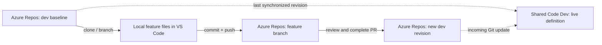

# Unit 5 — Make a local feature change

Allow **45–55 minutes** with local tools already installed. You will create a local feature branch, then complete the first Azure Repos pull request into `dev`.

## What you will learn

- Clone your existing Fabric source into an ordinary local Git working folder.
- Edit an exported notebook in an IDE while preserving its metadata and identity.
- Review, commit, push and merge a small feature through a pull request.
- Identify the merged source revision, the live Fabric definition and the last runtime result separately.

## Before you begin

Complete Unit 4 and keep your solution record. The final Code revision contains the **2490-cent** P01 Travel mug price and **357.20** for both expected monetary totals. Data Dev and the report show **357.20** revenue. If you followed an earlier draft that restored the original price, finish the revised price exercise and capture the updated Code revision. If you already started the feature, bring the updated `dev` into your existing feature branch before completing its PR. [Unit 4](../unit-04-connect-orchestration-configuration-and-reporting/README.md).

You need **Git**, **Visual Studio Code** and access to clone, create a branch and open a PR in your assigned **Azure DevOps Code repository**. Install/sign in using your organization's approved method before this exercise. Run `git --version` in PowerShell to confirm Git is available. No local Spark installation, Power BI Desktop or Fabric VS Code extension is required.

Continue the existing pilot's three role repositories and `dev` integration branch. Only the **Code repo** changes here; Data and Reporting retain their recorded source revisions. Do not clone the GitHub tutorial preparation repo as your participant solution or reorganize workspace/repo bindings. If your assigned layout differs, use its confirmed Code folder and integration branch with the facilitator.

Keep a private copy of the [feature record](resources/feature-record.md). Read the short [logical/physical ID reference](../../reference/fabric-item-identities.md); you will preserve the existing notebook's logical identity during the edit.

## Understand the source-to-runtime boundary



A local branch isolates **source files**, not Fabric runtime data. Saving these files changes your local checkout; a commit records that local state; pushing shares the feature branch. None of those actions switches the workspace branch, deploys the notebook or runs it.

Open the **cloned folder** in VS Code. Fabric's **Open in VS Code / VFS** experience is a different route: its saves synchronize to the remote workspace. We use ordinary Git files here so saving an unfinished feature does not publish it into shared Dev. See [Fabric VFS behavior](https://learn.microsoft.com/en-us/fabric/data-engineering/author-notebook-with-vs-code-vfs-mode).

## 1. Confirm and retain the integration baseline

1. In **Code Dev → Source control**, confirm Unit 4's final items are synchronized with `dev`. Resolve any unexplained changes with the facilitator before continuing; do not discard them or overwrite incoming content.
2. Save and close open notebook editors. For this exercise, coordinate a pause in UI changes to `build_sales` while you develop locally. If you are a pair, follow one local checkout together.
3. In **Azure DevOps → Repos → Files**, select your **Code repo** and branch **`dev`**. Confirm it contains the actual exported `build_sales` notebook, Variable Library and pipeline.
4. Record the full Code `dev` commit ID and retain the Data/Reporting revisions from Unit 4. Check **Code Dev → Workspace settings → Git integration** still points to that Code repo and `dev` without changing the connection.

**Expected result:** You have a known starting revision and an unchanged shared Dev mapping. A Git branch name alone is not a fixed source snapshot.

## 2. Clone the Code repository and open it locally

1. In **Azure DevOps → Repos → Files → Clone**, copy the Code repository's **HTTPS clone URL**. Use the actual assigned project/repo URL.
2. Choose a local development parent folder outside cloud-synchronized folders. Open PowerShell there. Replace the example URL below before running these commands; `tiny-sales-code` must be a new folder:

   ```powershell
   git clone "YOUR_CODE_REPOSITORY_HTTPS_URL" tiny-sales-code
   Set-Location tiny-sales-code
   git remote -v
   git switch dev
   git pull --ff-only origin dev
   git status --short
   git rev-parse HEAD
   ```

3. Complete the approved organizational sign-in if requested. Do not embed tokens in the clone URL or commit credentials. Confirm `origin` is your participant Code repo, the status is clean and the commit matches your recorded baseline. If `dev` has advanced, inspect the new commits and reconcile your baseline before continuing; if pull fails, preserve the checkout and diagnose it instead of forcing an overwrite.
4. In **VS Code → File → Open Folder**, select this new **`tiny-sales-code`** folder. Open **Terminal → New Terminal** and confirm it is at the repository root with `git status`.
5. Check the author values using `git config user.name` and `git config user.email`. If missing or wrong, set your own approved author details for **this repo only**:

   ```powershell
   git config --local user.name "YOUR_NAME"
   git config --local user.email "YOUR_APPROVED_COMMIT_EMAIL"
   ```

**Expected result:** VS Code shows ordinary files from your participant Code repo. The local clone contains source/history; it is not a copy of the lakehouse's runtime data. See [Azure Repos cloning](https://learn.microsoft.com/en-us/azure/devops/repos/git/clone?view=azure-devops).

## 3. Create the feature branch and locate the exported notebook

1. In the VS Code PowerShell terminal, create the branch:

   ```powershell
   git switch -c feature/exclude-returned-orders
   git branch --show-current
   ```

2. In Explorer, locate the notebook item folder whose `.platform` identifies **Notebook / build_sales**. It is normally `build_sales.Notebook`. Open its existing **`notebook-content.py`** as a text file. If your actual export is different, retain its filenames and ask the facilitator to check the representation before converting anything.
3. Read the sections for parameters, target guard, parameter validation, fixtures, transformation and persistence. Fabric's exported file contains cell delimiters and metadata as well as Python. Retain those sections; do not replace the whole file with the tutorial's initial starter or convert it to `.ipynb`.
4. Set a terminal variable to the actual repository-relative file path, including any assigned parent folder. For the current root-mapped Code repo:

   ```powershell
   $notebookFile = 'build_sales.Notebook/notebook-content.py'
   ```

5. Read the adjacent `.platform`'s `config.logicalId` and record it. Leave `.platform`, resource references, notebook settings, parameter/cell markers, workspace map and lakehouse metadata unchanged. A missing physical ID in `.platform` is expected; see the [ID reference](../../reference/fabric-item-identities.md).

**Expected result:** The feature branch is local, and you can identify the existing notebook source and logical ID. Code Dev remains connected to `dev`; do not switch it to the feature branch. See [notebook Git representation](https://learn.microsoft.com/en-us/fabric/data-engineering/notebook-source-control-deployment#notebook-representation-in-git).

## 4. Implement the returned-order rule

The fictional business now wants **revenue to exclude returned orders**. Keep all six rows for traceability and preserve gross revenue. A returned order contributes **0.00** to `revenue`; it is not a negative sale in this sample. The existing report's **Total Revenue** measure can keep summing the same column.

1. In the transformation section, find the existing line `.withColumn("revenue", F.col("gross_revenue"))`. Replace **that one chained call** with:

   ```python
   .withColumn(
       "revenue",
       F.when(
           F.col("is_returned"), F.lit(0).cast("decimal(12,2)")
       ).otherwise(F.col("gross_revenue")),
   )
   ```

2. Update the adjacent business-rule comment to explain that returned orders remain in the table but contribute zero revenue. Leave fixtures and the table schema unchanged.
3. In `EXPECTED_METRICS`, set `revenue` to **`Decimal("204.70")`** and retain `gross_revenue` at **`Decimal("357.20")`**. Keep the count and invalid-row checks and both calls to `validate_sales`.
4. Change the final success message's wording from **matches the baseline** to **matches the expected metrics**, retaining the `UNIT_01_PASS` marker. Save the local file.
5. Review the expected result independently. Returned orders O003 and O006 contribute gross amounts 12.50 and 140.00. The expected revenue is **357.20 − 12.50 − 140.00 = 204.70**.

   | Result | Before | After feature execution |
   | --- | ---: | ---: |
   | Rows / distinct orders | 6 / 6 | 6 / 6 |
   | Quantity / returned orders | 13 / 2 | 13 / 2 |
   | Gross revenue | 357.20 | 357.20 |
   | Revenue / report Total Revenue | 357.20 | 204.70 |
   | Invalid rows | 0 | 0 |

**Expected result** The existing notebook definition contains the new calculation and the 204.70 expectation. Review the source here. Fabric execution requires a workspace Spark session, which the later deployment exercise will use to verify the result.

## 5. Review and commit the local change

1. Open VS Code's **Source Control** view and select the changed notebook to inspect the side-by-side diff. Confirm the calculation, expected revenue, comment and success-message wording changed; generated metadata, guards, parameters and fixtures did not.
2. In the terminal, check the scope and whitespace:

   ```powershell
   git diff --stat
   git diff --check
   git diff -- $notebookFile
   ```

   No output from `git diff --check` means it found no whitespace/conflict-marker errors. It does **not** prove the calculation, notebook structure, Spark execution or bindings are correct. If a long diff opens in a pager, press `q` to return.
3. Stage **only this file**, then inspect what will be committed:

   ```powershell
   git add -- $notebookFile
   git diff --cached --stat
   git diff --cached -- $notebookFile
   ```

4. When the staged diff matches the intended scope, commit and record its full ID:

   ```powershell
   git commit -m "Exclude returned orders from Tiny Sales revenue"
   git rev-parse HEAD
   git status --short
   ```

**Expected result:** A local feature commit with a clean working folder and unchanged `.platform`. The commit exists on your computer; it has not yet been shared or deployed. See [VS Code source control](https://code.visualstudio.com/docs/sourcecontrol/overview) and [Git diff checks](https://git-scm.com/docs/git-diff).

## 6. Push, review and complete the pull request

1. Share the feature branch:

   ```powershell
   git push --set-upstream origin feature/exclude-returned-orders
   ```

2. Open your **Code repo → Repos → Pull requests → New pull request** in Azure DevOps. Set **source = `feature/exclude-returned-orders`** and **target = `dev`** explicitly; do not accept `main` just because it is offered.
3. Use the title **Exclude returned orders from Tiny Sales revenue**. State that returned rows contribute zero revenue and the expected result is **204.70**, with **357.20** gross. Record the diff review and whitespace check as the validation performed so far. Select **Create**. If you already have a draft from an earlier version of this exercise, check its base, updated amounts and file diff, then select **Publish** on that PR.
4. Open **Files** and **Commits**. Verify the intended notebook edit, its preserved logical ID and the feature commit. Record the PR URL and branches. Check the PR's merge status and satisfy any existing requirements. Review the diff yourself in a solo lab, or ask your partner to review if working in a pair.
5. When the PR is ready, select **Complete**. Choose **Squash commit** if the training repo permits it, or use the merge type specified for your repo. Select **Complete merge** after checking the options. If a required policy or reviewer blocks completion, ask the facilitator how to satisfy it. Leave policy override unchecked. [Complete an Azure Repos PR](https://learn.microsoft.com/en-us/azure/devops/repos/git/complete-pull-requests?view=azure-devops#complete-a-pull-request).
6. Confirm the PR status is **Completed**. Find the resulting commit on `dev` in Azure Repos and record its full ID alongside the feature commit. A squash merge creates a new target commit, so use the resulting `dev` commit as the integration checkpoint.

**Expected result** The reviewed feature is in `dev` and the completed PR links to its integration commit. Unit 6 adds an enforced build check for the next change.

## 7. Compare merged source with live Dev

1. Open **Code Dev → Source control**, refresh the pane and confirm it tracks **`dev`**. Observe the incoming notebook update. Leave it pending for the pipeline publishing exercise so you can compare the merged revision with the live definition. [Update workspace from Git](https://learn.microsoft.com/en-us/fabric/cicd/git-integration/git-get-started#update-workspace-from-git).
2. Check the persisted Data Dev/report baseline of **357.20**. Record it separately from the feature's expected **204.70**. If the workspace or report is already showing the feature, check whether an update and run occurred and record the actual revision and result.
3. Record the baseline, feature and resulting `dev` commits, completed PR, notebook path/logical ID, retained Data/Reporting revisions and workspace observations. [Feature record](resources/feature-record.md).

**Expected result** You can trace the change from local source through the completed PR to `dev` and explain which revision produced the current report.

## If something does not work

| Symptom | What to check |
| --- | --- |
| Clone/push fails authentication | Use the assigned organization/project and approved sign-in; confirm repo contribution/branch permissions with the facilitator. Never paste credentials into source. |
| Git asks for an author | Set repository-local `user.name` and `user.email`; author metadata is separate from authentication. |
| Branch already exists | Check whether you are resuming this exercise before creating another branch; retain existing work instead of deleting it. |
| Export file is missing or different | Confirm the Code repo/branch, Unit 4 Git capture and `.platform` item type/name. Do not invent a replacement export or copy the starter over the item. |
| The diff changes every line | Check editor encoding/line endings/formatting settings. Preserve the file format and narrow the edit before committing. |
| `.platform` or bindings changed | Stop and inspect the cause; this feature requires business-source edits only. Preserve unrelated work before correcting the scope. |
| Local Run fails on Spark or notebookutils | This is exported Fabric notebook source, not a standalone local program. No local notebook execution is required here. |
| Workspace shows a conflict or unexpected update | Stop competing edits, preserve both versions and identify the connected branch/revisions. Use the [conflict reference](../../auxiliary/aux-01-recover-from-source-conflicts/README.md); do not discard workspace changes to finish this unit. |
| PR targets `main` or changes unrelated items | Correct the target to the confirmed integration branch and inspect the branch base/file list before proceeding. |
| Your feature branch started from the earlier 342.20 baseline | Capture Unit 4's corrected baseline in `dev`. In a clean checkout on the feature branch, run `git fetch origin` and `git merge origin/dev`. If needed, resolve the diff with the facilitator. Keep P01 at 2490 cents, gross at 357.20 and feature revenue at 204.70. [Conflict recovery](../../auxiliary/aux-01-recover-from-source-conflicts/README.md). |
| Completion is blocked | Check the PR's conflicts, required policies and reviewer status. Satisfy the active requirements with the facilitator. |

## Completion checkpoint

- [ ] Your local clone points to the assigned Azure DevOps Code repo.
- [ ] `feature/exclude-returned-orders` contains one reviewed notebook-source feature; its logical ID, metadata, fixtures and schema are preserved.
- [ ] The expected feature revenue is 204.70, with gross revenue 357.20 and six orders, quantity 13 and two returns.
- [ ] The PR into `dev` is **Completed** and the resulting `dev` commit is recorded.
- [ ] The feature record separates the merged source, live definition, runtime result and validation performed.

Keep the local checkout and completed PR record for Unit 6. Start the next change from the updated `dev` and use it to exercise automated PR validation.

## References

- [Clone an Azure Repos repository](https://learn.microsoft.com/en-us/azure/devops/repos/git/clone?view=azure-devops).
- [Notebook source control and deployment](https://learn.microsoft.com/en-us/fabric/data-engineering/notebook-source-control-deployment).
- [VS Code source control](https://code.visualstudio.com/docs/sourcecontrol/overview).
- [Complete an Azure Repos PR](https://learn.microsoft.com/en-us/azure/devops/repos/git/complete-pull-requests?view=azure-devops#complete-a-pull-request).
- [Logical versus physical IDs](../../reference/fabric-item-identities.md).

[Previous: Unit 4](../unit-04-connect-orchestration-configuration-and-reporting/README.md) · [Tutorial index](../../README.md) · [Next: Unit 6](../unit-06-required-pr-validation/README.md)
