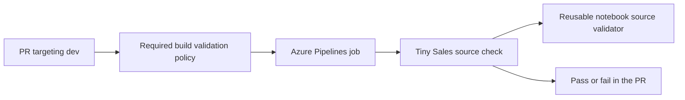

# Unit 6 — Turn review into a required check

Allow **35 minutes of working time** with an available Azure Pipelines agent. You will add a reusable source validator and a Tiny Sales check, then make a successful build a requirement for completing PRs into `dev`.

## What you will learn

- Run the same source check from the command line and Azure Pipelines.
- Connect a YAML pipeline to an Azure Repos build validation policy.
- Diagnose a failing check and follow the result from a revised commit to a completed PR.

## Before you begin

Use your participant **Code** repository and local checkout. Find the completed Unit 5 PR and the resulting `dev` commit. In the notebook export, the returned-order branch uses `F.lit(0)`, and `EXPECTED_METRICS` declares **357.20 gross** and **204.70 revenue**. Keep the incoming Fabric update pending for the later publishing exercise. [Unit 5](../unit-05-make-a-local-feature-change/README.md).

You need permission to create an Azure Pipeline and queue it on the supplied agent. You or the facilitator need **Edit policies** permission for `dev`. This lesson uses a Microsoft-hosted Ubuntu agent with Python 3.12. Local Python 3.12 is optional. [Python on Azure Pipelines](https://learn.microsoft.com/en-us/azure/devops/pipelines/ecosystems/customize-python) · [Azure Repos branch policies](https://learn.microsoft.com/en-us/azure/devops/repos/git/branch-policies?view=azure-devops#set-build-validation).

## How the pieces fit



The validator reads the notebook's `.platform` metadata and compiles its Python source without executing it. The project check then inspects the `revenue` expression and the two declared monetary totals from Unit 5. This is a **source contract** for the workshop notebook. A pass tells you those parts match the agreed definition. Fabric execution will verify table writes, cross-workspace bindings and the report later.

The **branch policy** queues this Azure Pipeline against the PR's proposed merge with `dev` and uses the run result when deciding whether completion is allowed. In Azure Repos Git, you configure that trigger on the target branch. The supplied YAML sets `trigger: none` so ordinary pushes do not queue a separate CI run. [Azure Repos PR triggers](https://learn.microsoft.com/en-us/azure/devops/pipelines/repos/azure-repos-git?view=azure-devops#pr-triggers).

## 1. Add the validator and pipeline

1. In your Code repository checkout, confirm `git status --short` is clean. Update `dev`, then start a second branch.

   ```powershell
   git switch dev
   git pull --ff-only origin dev
   git switch -c feature/required-pr-validation
   ```

2. Copy the three supplied files into the paths below, relative to the participant Code repository root. On GitHub, open each file and use **Raw** to get the source text.

   | Supplied file | Destination in your Code repo | Responsibility |
   | --- | --- | --- |
   | [Notebook validator](../../../../toolkit/notebook_validation.py) | `toolkit/notebook_validation.py` | Read `.platform`, validate Notebook type and logical ID, compile the Python export and return its parsed syntax. |
   | [Tiny Sales check](../../../../sample/tiny-sales/ci_check.py) | `checks/validate_tiny_sales.py` | Check this project's revenue expression and declared totals. |
   | [CI YAML](../../../../pipelines/notebook-ci.yml) | `pipelines/notebook-ci.yml` | Set up Python and call the check on the notebook item folder. |

3. In the YAML, confirm `NOTEBOOK_ITEM_DIR` is the folder you recorded in Unit 5. The supplied value is `build_sales.Notebook`. If your folder differs, enter its repo-relative path using forward slashes. The value points to the item folder containing `.platform` and `notebook-content.py`.
4. If you have local Python 3.12, run the check from the Code repository root. Use the same path as in the YAML. A successful run prints `VALIDATION PASSED`. Azure Pipelines will run this command as part of the required exercise.

   ```powershell
   python -B -m checks.validate_tiny_sales --item-dir 'build_sales.Notebook'
   ```

5. Review the three new files, then stage and push them.

   ```powershell
   git add -- toolkit/notebook_validation.py checks/validate_tiny_sales.py pipelines/notebook-ci.yml
   git diff --cached --check
   git diff --cached --stat
   git commit -m "Add Tiny Sales source validation pipeline"
   git push -u origin feature/required-pr-validation
   ```

**Expected result** Azure Repos shows the three files on your feature branch. The notebook still contains the reviewed Unit 5 rule.

## 2. Register the pipeline and require it on `dev`

1. In your Azure DevOps project, select **Pipelines → New pipeline → Azure Repos Git**, then select the participant Code repo.
2. Choose **Existing Azure Pipelines YAML file**. Select branch `feature/required-pr-validation` and path `/pipelines/notebook-ci.yml`. Select **Continue**. On the review screen use the dropdown beside **Run** to select **Save**. If you use **Run** at this point, treat that run as a setup check and use the feature branch as its source. Record the name of the saved pipeline. [Register an existing YAML pipeline](https://learn.microsoft.com/en-us/azure/devops/pipelines/get-started/clone-import-pipeline?view=azure-devops#clone-or-copy-a-pipeline).
3. In **Repos → Branches**, open the menu beside **`dev`** and select **Branch policies**. Under **Build validation**, select **+** and set the following values. Ask the facilitator to apply them if branch-policy editing is delegated.

   | Field | Value |
   | --- | --- |
   | Build pipeline | The pipeline saved in step 2 |
   | Path filter | Blank, so the policy covers all changes to `dev` |
   | Trigger | **Automatic** |
   | Policy requirement | **Required** |
   | Build expiration | **Immediately when `dev` is updated** |
   | Display name | **Tiny Sales source validation** |

4. Save and check that the policy is enabled on `dev`. Keep the existing branch requirements in place. [Configure build validation](https://learn.microsoft.com/en-us/azure/devops/repos/git/branch-policies?view=azure-devops#set-build-validation).

**Expected result** Azure Repos lists **Tiny Sales source validation** as a required, automatic check on `dev`.

## 3. Watch the policy block a faulty change

1. In the exported `notebook-content.py` on your feature branch, change `F.lit(0)` to `F.lit(1)` in the `withColumn("revenue", ...)` expression. This is valid Python and would give each returned order 1.00 revenue. Keep the declared expectations and check files as reviewed.
2. Review the one-line diff, commit the notebook file and push the feature branch. Open an **active** PR titled **Add required Tiny Sales source validation** from `feature/required-pr-validation` into `dev`. Note the intentional defect in the PR description so reviewers can follow the exercise. Use **Create** to open it for review.
3. On the PR's **Overview**, wait for the required build to finish. Open its run from the policy result and find **Validate Tiny Sales notebook source**. Confirm the failure says `Returned orders must contribute zero revenue` and reports the actual `F.lit(1)` expression. Check that Azure Repos reports the required check as failed and blocks normal completion. Record the source commit, run link and failure in the worksheet. [CI evidence worksheet](resources/ci-evidence.md).

**Expected result** The agent runs the checker and the checker returns a failure for the deliberate defect. If the job never starts, or the task cannot find the source file or Python, resolve that setup issue first. The exercise checkpoint is the specific business-rule diagnostic in the job log.

## 4. Fix the source and complete the PR

1. Restore `F.lit(0)` in the same expression. Review the one-line fix, commit it and push to the same feature branch. Keep the same PR open.
2. Wait for the **new** required run. Find `VALIDATION PASSED` in the job log and check that the PR policy is green for the updated revision. Record the new source commit and run link. The build can show a generated PR merge commit, which is distinct from both your feature commit and the final `dev` commit.
3. On the PR's **Files** tab, verify the final proposed changes are the three validation files. The temporary notebook edit should have disappeared from the final diff. Update the PR description with the failing and passing run links and ask for any required review.
4. Complete the PR using the merge type permitted by your repo. Prefer squash if available so `dev` receives one commit with the validation files. Record the resulting `dev` commit and check that the build validation policy remains enabled. [Complete an Azure Repos PR](https://learn.microsoft.com/en-us/azure/devops/repos/git/complete-pull-requests?view=azure-devops#complete-a-pull-request).

**Expected result** The completed PR links the failed and successful checks to the source revisions. Future PRs into `dev` use the required pipeline. Carry the merged revision and the worksheet into the configuration lesson.

## If something does not work

| Symptom | What to check |
| --- | --- |
| The YAML picker cannot find the file | Select the participant Code repository and the pushed feature branch, then check the exact `/pipelines/notebook-ci.yml` path. |
| The job waits or reports no hosted parallelism | Ask the facilitator to verify that your project can queue on the designated agent and has available job capacity. [Parallel jobs](https://learn.microsoft.com/en-us/azure/devops/pipelines/licensing/concurrent-jobs?view=azure-devops). |
| No build appears on the PR | Confirm the PR is active, targets `dev`, and has the enabled **Automatic / Required** policy attached to the saved pipeline. |
| The check reports missing `.platform` or notebook source | Check `NOTEBOOK_ITEM_DIR` and the item folder in the PR revision. |
| The corrected run reports a totals mismatch | Inspect `EXPECTED_METRICS` in the checkout. Unit 5 expects gross `Decimal("357.20")` and revenue `Decimal("204.70")`. |
| Build passed but completion is still blocked | Inspect the other policies, required reviewers and conflicts on the PR. |

## Completion checkpoint

- [ ] The Code repo contains the reusable validator, project check and CI YAML.
- [ ] `dev` has an enabled automatic required build policy for the pipeline.
- [ ] The deliberately faulty revision failed with the intended diagnostic and normal PR completion was blocked.
- [ ] The corrected revision passed and the PR was completed through the branch's requirements.
- [ ] The worksheet records both runs, the completed PR and the resulting `dev` commit.

[Previous unit](../unit-05-make-a-local-feature-change/README.md) · [Tutorial index](../../README.md)
