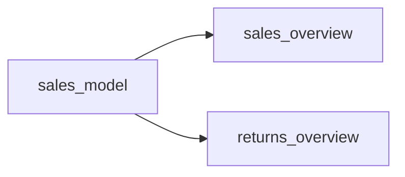

# Unit 12 — Use a shared Fabric deployment starter

**Optional advanced lab · about 60 minutes after setup.** Migrate your Tiny Sales CI and Test pipelines to the shared starter. Add a report, see its project check fail and pass, then verify the new report in Test.

## Before you begin

Start with the Code, Data and Reporting repositories and the Test and Prod releases from [Unit 10](../../section-04-release-automation/unit-10-release-to-prod/README.md). Open the successful Test release artifact from Unit 9 so you can compare the original revisions, target IDs and item IDs with this lab's evidence. Coordinate a time with your partner so your Test workspaces have one active release at a time.

## 1. Identify the files the existing pipelines use

In Azure DevOps, open the existing pipelines under **Pipelines**. Match the Code repository and YAML paths to the table. If your team chose different pipeline names, use those names throughout the lab.

| Existing pipeline | Registered YAML path | When you replace its YAML |
| --- | --- | --- |
| **Tiny Sales - Notebook CI** | `/.azuredevops/pipelines/notebook-ci.yml` | In the Code PR to `dev` |
| **Tiny Sales - Test Release** | `/.azuredevops/pipelines/test-release.yml` | In the same Code PR |
| **Tiny Sales - Prod Release** | `/.azuredevops/pipelines/prod-release.yml` | After the successful Test deployment, if you do the optional Prod extension |

Use the existing pipeline registrations and replace the files at the paths they already point to. This keeps the CI build validation policy attached to the same pipeline and lets the Test release continue using its scoped service connection permission. In Unit 10 the Prod pipeline took its YAML from Code `main`, so the changes to Code `dev` can be tested first.

From a clean local **Code** checkout, create the feature branch:

```powershell
git fetch origin
git switch -c feature/shared-release-starter origin/dev
```

**Expected result** You are editing a feature branch of Code. You know which two YAML paths will pick up your changes after the PR.

## 2. Locate the two notebook source folders

Open the Code source root recorded in `sources.code.folder` in `config/tiny-sales-release.yml`. The workshop uses `.` for the repo root. Locate both notebook folders there.

| Notebook | Files and source |
| --- | --- |
| `build_sales.Notebook` | Use `.platform` and `notebook-content.py` from your Unit 10-tested Code revision. This is the notebook with the environment parameters and reviewed Tiny Sales revenue rule. |
| `validate_release.Notebook` | Use the two files added in Unit 9. The copy-ready sources are [`.platform`](../../../../sample/tiny-sales/validate_release.Notebook/.platform) and [`notebook-content.py`](../../../../sample/tiny-sales/validate_release.Notebook/notebook-content.py). The notebook checks gross revenue of **357.20** and recognized revenue of **204.70**. |

If the validation notebook folder is missing from your checkout, first open the verified Code revision in Azure Repos and recover both files from there. That gives you the same `config.logicalId` used by Test and Prod. If you are creating the notebook source for the first time, copy both starter files into `validate_release.Notebook/` and replace `REPLACE_WITH_STABLE_GUID` in `.platform` with one new GUID. In PowerShell, run `(New-Guid).Guid` to generate it. Use that value across environments. Save the metadata file as `.platform`, including the leading dot. [Unit 9 notebook creation](../../section-04-release-automation/unit-09-release-to-test/README.md#2-add-the-test-release-pipeline).

**Expected result** The Code source has both complete notebook folders. You can open the validation notebook's Python and find the two assertions the Test smoke check will run.

## 3. Install the starter and replace the two pipeline files

1. Copy the full [`deployment_starter/` directory](../../../../deployment_starter/) to the Code root using the files from this tutorial revision. Refresh the following shared toolkit files at their existing Code paths from the same revision. The starter calls them for plan validation, workspace preflight, item binding and publishing.

   | Canonical source | Destination in Code |
   | --- | --- |
   | [`release_plan.py`](../../../../toolkit/release_plan.py) | `toolkit/release_plan.py` |
   | [`fabric_preflight.py`](../../../../toolkit/fabric_preflight.py) | `toolkit/fabric_preflight.py` |
   | [`tiny_sales_release.py`](../../../../toolkit/tiny_sales_release.py) | `toolkit/tiny_sales_release.py` |
   | [`requirements-planning.txt`](../../../../toolkit/requirements-planning.txt) and [`requirements-release.txt`](../../../../toolkit/requirements-release.txt) | The same filenames under `toolkit/` |

2. Copy the starter's consuming files to these exact paths. A *wrapper* is the short project YAML that declares the resources and points to the shared template.

   | Ready-to-copy source | Destination in Code |
   | --- | --- |
   | [CI wrapper](../../../../sample/tiny-sales/unit-12/ci.yml) | Replace `.azuredevops/pipelines/notebook-ci.yml` |
   | [Test wrapper](../../../../sample/tiny-sales/unit-12/test.yml) | Replace `.azuredevops/pipelines/test-release.yml` |
   | [Tiny Sales project check](../../../../sample/tiny-sales/unit-12/validate_returns.py) | Add `checks/validate_returns.py` |

3. In **both** wrappers, replace `REPLACE_WITH_DATA_REPO` and `REPLACE_WITH_REPORTING_REPO` with the names already in `sources.data.repository` and `sources.reports.repository`. Use the same Azure Repos spelling as the Unit 9 YAML. Keep `mask: config/tiny-sales-release.yml` in both files and `target: test` in the Test wrapper.
4. Confirm the Code files from Unit 6 are present. If restoring them, use [`checks/validate_tiny_sales.py`](../../../../sample/tiny-sales/validate_tiny_sales.py) and [`toolkit/notebook_validation.py`](../../../../toolkit/notebook_validation.py). The new project check calls that same notebook contract before testing the returns measure.
5. Follow `extends.template` in the two wrappers. The [CI template](../../../../deployment_starter/templates/ci.yml) calls the validation steps. The [release template](../../../../deployment_starter/templates/release.yml) validates a Test candidate first, then hands it to the job with the Fabric connection. In [`release.py`](../../../../deployment_starter/release.py), find `run_project_check` and `publish` to see where each happens.

**Expected result** Both registered YAML paths contain wrappers. The wrappers point to templates and pass project inputs, and the starter can load the project check from `checks/`.

## 4. Add the report and update the release mask

1. In **Reporting Dev**, create a thin report named `returns_overview` over the existing `sales_model`. Add a card using its **Returned Orders** measure. If the model needs that measure, use the [Tiny Sales measure definitions](../../../../sample/tiny-sales/sales-model-measures.dax). [Unit 4 report creation](../../section-03-team-delivery/unit-04-connect-orchestration-configuration-and-reporting/README.md).
2. Commit the report and any model change through the Reporting `dev` workflow. Open the resulting commit in Azure Repos. In the Reporting source folder, check that `returns_overview.Report/.platform` has its own logical ID and `definition.pbir` has `datasetReference.byPath.path: ../sales_model.SemanticModel`. The report and model are sibling folders. If the export differs, review the binding with the facilitator before queuing the release.
3. In Code's `config/tiny-sales-release.yml`, set `sources.reports.revision` to that full Reporting commit hash. Use the existing Data pin unless you reviewed a Data change for this candidate.
4. Copy the two entries under `items` in [mask-additions.yml](../../../../sample/tiny-sales/unit-12/mask-additions.yml) into your existing `items` block. **Replace** the old `project_checks` block with the one in the same file. It selects `checks.validate_returns`.
5. Review the edges. The `validation` notebook binds to `lakehouse`. The new `returns_report` binds to the existing `model`. Keep the other items, bindings and workspace mappings in the mask.



**Expected result** The mask points at the Reporting commit that contains the new report, and declares the binding the export uses.

## 5. Check the environment configuration

Open the filled-in Unit 9 files and compare them with your assigned Test inventory. The starter uses these project values during preflight.

| Location | What to verify |
| --- | --- |
| `config/tiny-sales-release.yml` → `environments.test` | The assigned Code, Data and Reporting Test workspace IDs, and `value_set: Test` |
| `config/environments/test.yml` → `variables` | The existing Test UAMI name and service connection reference, and the exact display names for the three IDs above |
| Azure DevOps → **Project settings → Service connections** | **Tiny Sales - Test Release** is authorized on the Test connection |

The Test wrapper passes `target: test` to the template, which loads `config/environments/test.yml`. The names give preflight an independent check on the IDs. Keep your populated environment file and correct only values that differ from the assigned inventory.

Authorize **Tiny Sales - Notebook CI** for the Data and Reporting repos if required. CI now verifies the pinned Data and Reporting checkouts and inspects the Reporting model export. In each repo's **Project settings → Repositories → Security → Pipeline permissions**, add the CI pipeline, or ask the repo administrator to approve its access request. [Repository pipeline permissions](https://learn.microsoft.com/en-us/azure/devops/pipelines/process/repository-resource?view=azure-devops#add-pipeline-permissions-to-a-repository-resource).

**Expected result** CI can read all three source checkouts. The Test release has the workspace configuration and the authorized connection it needs for live preflight.

## 6. Watch the same CI policy reject and accept the change

1. Open `checks/validate_returns.py` and find `run(repositories, plan)`. It runs the notebook source contract, then checks for the required measure in the semantic model source. For this failure drill, set `REQUIRED_MEASURE` to `"Returns Count"` so the shared model stays usable while CI exercises the diagnostic.
2. Review and commit the Code changes, push your feature branch, and open **Migrate Tiny Sales to the shared release starter** into `dev`. Use the usual required CI check on the PR. You can use this description:

   ```markdown
   ## Change
   Migrate the existing CI and Test YAML to the shared starter.
   Add the returns report dependency and the Tiny Sales project check.

   ## Validation
   - Reviewed Reporting source revision: <commit>
   - Missing-measure failure and corrected result: <run links>
   - Test preflight and publish after merge: <run links>
   ```

3. Open the required CI run. Find the missing-measure message in the validation log and in **candidate-validation → validation.json**. Confirm it came from the project check after the release plan and the pinned sources were read.
4. Restore `REQUIRED_MEASURE` to `"Returned Orders"`. Commit and push the fix to the same branch. Confirm required CI passes, add both run links to the PR and complete it through the normal review workflow.

**Expected result** The existing **Tiny Sales - Notebook CI** registration checks the new candidate. The corrected check and wrapper are now in Code `dev`.

## 7. Preflight and publish through the existing Test pipeline

1. Open **Tiny Sales - Test Release** and queue from **dev**. Leave **Publish to Test after preflight** clear for the first run.
2. Open **candidate-validation → validation.json**. Confirm the exact Code, Data and Reporting revisions, the report and its model in the resolved plan, and the passed project check. Open **test-release-evidence → test-release.json** and look for `preflight_passed`, the verified Test workspace names and the starter version.
3. Queue again from the same `dev` revision with **Publish to Test after preflight** selected. In the release artifact, confirm `status: published`, the **Test** value set and the physical ID for `returns_report`. Its initial creation appears in `created_items`. Compare the existing notebook and lakehouse IDs with the earlier Test release.
4. In **Reporting Test → Lineage view**, confirm `returns_overview` uses the Test `sales_model`. Run the [Tiny Sales Test smoke checks](../../section-04-release-automation/unit-09-release-to-test/README.md#4-review-what-changed) and confirm the new card shows **2**.

**Expected result** The new report is in Test and binds to the intended model. The validation and publish evidence refer to the same source revisions and starter version.

## Optional — Prepare the existing Prod pipeline to consume the new Test run

1. Follow the [Unit 10 promotion steps](../../section-04-release-automation/unit-10-release-to-prod/README.md#2-protect-main-and-promote-the-tested-code-commit) to bring the exact tested Code commit into `main`. Use **Merge (no fast forward)** so the tested commit stays reachable.
2. On a Prod tooling branch from the updated `main`, copy the [Prod wrapper](../../../../sample/tiny-sales/unit-12/prod.yml) over `.azuredevops/pipelines/prod-release.yml`. Fill in the same Data and Reporting repo names, and verify `resources.pipelines[].source` is the registered Test pipeline name. In the populated `config/environments/prod.yml`, change `approvedTestRunId` to the numeric run ID of the successful starter Test **publish**.
3. Review and merge the wrapper and settings through the Prod PR workflow. Queue the existing **Tiny Sales - Prod Release** from `main`, select that Test run in the pipeline resource picker, and use the [Unit 10 approval workflow](../../section-04-release-automation/unit-10-release-to-prod/README.md#4-authorize-and-approve-the-prod-run). The manifest check requires the same tested source and shared implementation version.

## If something does not work

| Symptom | What to check |
| --- | --- |
| CI waits for authorization | Check pipeline permissions for **Tiny Sales - Notebook CI** on both dependency repos. |
| A template path fails to resolve | Compare the wrapper's `extends.template` and the location of `deployment_starter/` at the Code root. Check that both are committed to the branch the run uses. |
| The publisher reports an unexpected item or binding | Check both notebook folders, the report's exported model reference, and the two added mask entries. |
| The Test run finishes at preflight | Check the queue parameter and compare the source revision before starting a publishing run. |

## Completion checkpoint

- [ ] The existing CI and Test registrations read the new wrappers from their original YAML paths.
- [ ] The project check failed with the intended diagnostic and passed after correction.
- [ ] The Test release evidence records the reviewed candidate and the starter version.
- [ ] The new report is bound to the Test model and shows **2** returned orders.

## What you can now explain

Which inputs did Tiny Sales supply, and which steps came from the shared starter? Use your PR, validation artifact and Test lineage view to explain how the report got from a pinned source commit to the target model. This applies **MS-03 Change control and traceability**, **MS-06 Environment configuration**, **MS-08 Release validation** and **MS-14 Release evidence**. [Fabric Minimum Standard](../../../source-guidelines/fabric-minimum-standard.md#minimum-standard-by-operating-model).

[Closing recap](../../closing-recap.md) · [Tutorial index](../../README.md)
