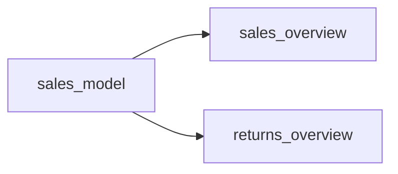

# Unit 12 — Use a shared Fabric deployment starter

**Optional advanced lab · about 60 minutes after setup.** Publish an additional report to Test through shared YAML and Python. Use a project check to catch a missing business measure before publishing.

## Before you begin

Use the Tiny Sales Code, Data and Reporting repositories and the seeded Test workspaces from [Unit 10](../../section-04-release-automation/unit-10-release-to-prod/README.md). The Test pipeline needs access to the pinned Data and Reporting histories and authorization on the Test service connection. Use the workspace IDs, names, value sets and Test UAMI from your own run. Pause parallel Test releases while you compare results with your partner. [Unit 9 Test setup](../../section-04-release-automation/unit-09-release-to-test/README.md).

## 1. Open the starter and identify what you supply

Read the [deployment starter](../../../../deployment_starter/README.md), then compare the [CI template](../../../../deployment_starter/templates/ci.yml) and the [release template](../../../../deployment_starter/templates/release.yml) with the [Tiny Sales wrappers](../../../../sample/tiny-sales/unit-12/). The wrapper selects the mask and declares repository resources. The templates run the jobs. The [Python entry point](../../../../deployment_starter/release.py) checks the candidate and calls the publisher. Follow `validate` and `publish` to see where the project check runs and where publishing signs in to Fabric.

In your Code repo, branch from current `dev` and copy the canonical [deployment_starter directory](../../../../deployment_starter/) at the same path. Bring over the matching files below from the same tutorial revision. These are shared implementation files.

- `toolkit/release_plan.py`, `toolkit/fabric_preflight.py` and `toolkit/tiny_sales_release.py`
- `toolkit/requirements-planning.txt` and `toolkit/requirements-release.txt`

Copy [ci.yml](../../../../sample/tiny-sales/unit-12/ci.yml) and [test.yml](../../../../sample/tiny-sales/unit-12/test.yml) as `.azuredevops/pipelines/starter-ci.yml` and `starter-test.yml` in Code. Fill in your Data and Reporting repo names in both. The lab uses new pipeline definitions so you can compare them with the earlier ones.

## 2. Add a report and declare its dependency

In Reporting Dev, create a **thin report** named `returns_overview` over the existing `sales_model`. Include a card using its **Returned Orders** measure. [Unit 4 report creation](../../section-03-team-delivery/unit-04-connect-orchestration-configuration-and-reporting/README.md).

Commit the report and any model change through the team's Reporting `dev` workflow. Open the export in Git and check:

- `returns_overview.Report/.platform` has the report's name and its own logical ID.
- `returns_overview.Report/definition.pbir` refers to `../sales_model.SemanticModel` through `datasetReference.byPath`. Both item folders belong to the same Reporting source root. Review the exported reference before you release.
- `sales_model.SemanticModel/definition/tables/` includes the **Returned Orders** measure. If you need to add it, use the [Tiny Sales measures](../../../../sample/tiny-sales/sales-model-measures.dax).

In Code, update the Reporting source pin to the full commit you just reviewed. Merge the [two item declarations](../../../../sample/tiny-sales/unit-12/mask-additions.yml) into your existing release mask. The starter takes the validation notebook from the graph as well. Keep the existing source roles and target mapping. The new report's binding adds this edge to the existing plan:

The arrows show which model must be available to each report. The exported reference and the declared binding both matter. The starter checks that they agree before publishing.

## 3. Register a project check and see it fail

Copy [validate_returns.py](../../../../sample/tiny-sales/unit-12/validate_returns.py) to `checks/validate_returns.py` in Code. Replace the `project_checks` mapping as shown in the [mask additions](../../../../sample/tiny-sales/unit-12/mask-additions.yml).

Read `run(repositories, plan)`. The starter supplies the verified checkouts and resolved plan. The project function requires the measure used by the new report. This is a static check on the exported model.

1. On the feature branch, temporarily set `REQUIRED_MEASURE` to `"Returns Count"`. Push and queue the **Tiny Sales - Starter CI** pipeline from this feature branch, using `.azuredevops/pipelines/starter-ci.yml`. Give the pipeline access to both repository resources.
2. Open the failed run and find the project diagnostic in its validation log and `candidate-validation/validation.json`. Restore the check to **Returned Orders** and run CI again. Compare the check result and declared source revisions. A team can use this pipeline as a required PR build after validating the setup.
3. Use the project's normal PR process to merge the corrected Code candidate into `dev`.

## 4. Publish the validated graph to Test

Create **Tiny Sales - Starter Test** from `.azuredevops/pipelines/starter-test.yml`. Authorize that pipeline on the Test connection and the Data and Reporting repositories as in Unit 9. Open `config/environments/test.yml` and the Test section of the mask side by side. The mask supplies workspace IDs and the selected value set. The environment file supplies the expected names and the connection reference.

Queue from `dev` with **Publish to Test after preflight** clear. Open both artifacts. Confirm the resolved plan includes the new report and its model, the check passed against the pinned Reporting revision, and the live preflight verified the Test targets. Queue again with publishing enabled. Check the successful release:

- In `test-release-evidence/test-release.json`, check the source revisions, starter version, configured connection, target names, active value set and the new report's physical ID. An initial creation appears as `returns_report` in `created_items`.
- In Fabric **Reporting Test → Lineage view**, confirm `returns_overview` uses the **Test** `sales_model`. Run [the Tiny Sales Test smoke checks](../../section-04-release-automation/unit-09-release-to-test/README.md#4-review-what-changed) and confirm the new card shows **2**.

The [Prod wrapper](../../../../sample/tiny-sales/unit-12/prod.yml) consumes the completed Test run. In the [Unit 10 approval workflow](../../section-04-release-automation/unit-10-release-to-prod/README.md), update the reviewed Prod settings with that run ID, promote the tested Code revision to `main`, and select the matching pipeline resource version when queuing Prod. The starter compares the manifest, source pins and shared implementation version before publishing. The hands-on lab ends in Test.

## Completion checkpoint

You can point to the project mask, the static check and the shared code. Show the rejected check, corrected release and verified Test report binding. The manifest links the publish to the candidate, while the Fabric smoke check shows what the deployed solution did. This applies **MS-03 Change control and traceability**, **MS-06 Environment configuration**, **MS-08 Release validation** and **MS-14 Release evidence**. [Fabric Minimum Standard](../../../source-guidelines/fabric-minimum-standard.md#minimum-standard-by-operating-model).

[Closing recap](../../closing-recap.md) · [Tutorial index](../../README.md)
